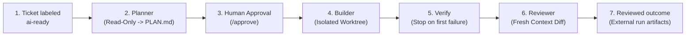

# Software Factory

A **vendor-neutral, Linux-first ticket workflow** that plans, implements, verifies, and reviews scoped changes. The legacy Phase 1 API uses a caller-provided `ai/` linked worktree. The Phase 2 managed API adds approval-bound worktree lifecycle, verification repair attempts, protected-file checks, Draft PR delivery, and notifications. Phase 2 has synthetic Git and mocked HTTP tests; live GitHub and Telegram acceptance is not established.

---

## Core Principles

- **Small, Focused Agent Roles:** Work is split into **Planner** (read-only), **Builder** (write + test), and **Reviewer** (fresh-context diff audit) so no single session loses focus.
- **Deterministic Verification:** Configured `secret_scan`, `lint`, `typecheck`, and `test` checks run in order. Managed runs allow up to three total verification attempts, including the first attempt.
- **Linux Isolation:** Child commands run through Bubblewrap (`bwrap`) with user namespaces and scoped workspace access. Legacy calls accept a caller-provided linked worktree; managed calls create an isolated worktree outside the repository.
- **Configurable CLI and Trackers:** OpenCode, Agy, and Codex runners plus Local Markdown and GitHub trackers are selected through configuration; OpenCode remains the default.
- **Privacy & Fail-Closed Security:** Supports per-repo `ignore_paths`, pre-push secret scanning (`gitleaks`), Zero-Footprint external contexts, and `allow_cloud_llm: false` fail-closed routing. Protected runs receive no raw Git metadata.

---

## How It Works



---

## Quick Start

Development requires Node.js v26.13.1. Production execution requires Linux, Bubblewrap with user namespaces,
a private `config/runtime-profile.yaml`, and a dedicated unprivileged service account. The sandbox uses an
empty controlled root and fresh home; see the [runtime profile setup](INTEGRATION_GUIDE.md#required-linux-runtime-profile).
Install the locked dependencies and run checks with:

```bash
yarn install --frozen-lockfile
yarn verify
```

1. **Set up environment variables:**

   ```bash
   cp .env.example .env
   ```

   Fill in only the keys for the providers and trackers you use (`.env` is gitignored).

2. **Configure global adapters and models:**
   Review and adjust [config/factory.yaml](config/factory.yaml) and [config/models.yaml](config/models.yaml).

3. **Register your repositories:**

   ```bash
   cp config/repos.example.yaml config/repos.yaml
   ```

   Add your local repository paths, `allowed_approvers`, `verification` commands, and `privacy` rules (`config/repos.yaml` is gitignored).

4. **Follow the full setup walkthrough:**
   See [INTEGRATION_GUIDE.md](INTEGRATION_GUIDE.md) for step-by-step instructions on connecting personal, team, and confidential NDA repositories.

TypeScript 6.0.2 is pinned because the current stable TypeScript ESLint parser does not support TypeScript 7 yet. Upgrade when stable parser support is available.

## Managed Phase 2 API

The built `dist/orchestrator.js` entry re-exports `planManagedTicket` and `resumeManagedTicket`. The caller provides the resolved repository, factory settings, an already configured tracker, the factory root, and a trusted external directory for run artifacts. Load configuration with `dist/config_loader.js` and provide its resolved factory, repository, and secrets map to both calls.

Set `workspace.use_worktree: true`, `workspace.draft_pr_only: true`, and an absolute `workspace.worktree_root` outside the target repository and factory artifacts. The engine resolves symlinked ancestors and validates the canonical root before creating directories. Set `limits.max_self_heal_retries` to the desired total verification-attempt limit; it defaults to 3, so at most two repair Builder runs follow a failing first attempt. Configure a nonempty `verification.secret_scan` command.

Planning publishes a plan and returns `status: "needs_approval"` with a `runFile`. After a human approves that exact plan through the configured tracker, resume with the same run file. The approval must match the stored plan hash.

```ts
import { loadConfig } from "../dist/config_loader.js";
import { planManagedTicket, resumeManagedTicket } from "../dist/orchestrator.js";
import type { TrackerAdapter } from "../src/adapters/tracker/types.js";

const loaded = await loadConfig({
  factoryPath: "./config/factory.yaml",
  modelsPath: "./config/models.yaml",
  reposPath: "./config/repos.yaml",
  repoId: "sample",
});
const repository = loaded.config.repos[0];
if (!repository) throw new Error("Configured repository was not found");

async function plan(tracker: TrackerAdapter) {
  return planManagedTicket({
    repository,
    factory: loaded.config.factory,
    tracker,
    factoryRoot: "/opt/software-factory",
    ticketId: "17",
    outputDirectory: "/var/lib/software-factory/runs",
    secrets: loaded.secrets,
  });
}

async function resumeApproved(tracker: TrackerAdapter, runFile: string) {
  return resumeManagedTicket({
    repository,
    factory: loaded.config.factory,
    tracker,
    factoryRoot: "/opt/software-factory",
    runFile,
    secrets: loaded.secrets,
  });
}
```

`TrackerAdapter` is supplied by the caller's configured tracker setup. For Local Markdown, record approval for the current `factory_plan_hash` in the ticket before resuming. Persist the returned `runFile` between planning and approval. See the [managed lifecycle guide](INTEGRATION_GUIDE.md#managed-phase-2-lifecycle) for GitHub delivery settings, claim scope, cleanup behavior, and logging.

Managed GitHub Draft PRs contain the full Reviewer report in the PR body. If PR creation has an uncertain response, the API returns `delivery_pending`, retains the active ticket claim and committed branch, and removes only its owned worktree. Resume stops before agents or GitHub requests until an operator reconciles the remote result; creation is not retried automatically. If a known Draft PR cannot be reflected in tracker state, the result retains its URL and reports a tracker warning.

---

## Repository Structure

```text
software_factory/
├── config/
│   ├── factory.yaml                     # Global adapters, limits, worktree & security flags
│   ├── models.yaml                      # Provider registry & role-to-model routing
│   ├── repos.example.yaml               # Committed template for connecting target repos
│   ├── repos.yaml                       # Local private repo registry (gitignored)
│   └── contexts/
│       └── global-factory-rules.md      # Global security & workflow rules (merge precedence)
├── src/
│   ├── agents/                          # Planner, Builder, Reviewer roles + run.sh entry point
│   ├── engine/                          # Orchestrator, state_manager, workspace, context_builder
│   ├── self_healing/                    # Verifier, error_parser, retry_loop
│   └── adapters/                        # Swappable llm, cli_runner, tracker, git_host, notifier
├── templates/                           # Starter templates (e.g., AGENTS.template.md)
├── docs/
│   ├── architecture.md                  # Module breakdown & adapter architecture
│   └── system_design.md                 # Sequence diagrams, state machine & JSON contracts
├── logs/                                # Run history, error logs, and cost tracking
├── AGENTS.md                            # Development rules, workflow, and code style guide
├── INTEGRATION_GUIDE.md                 # Step-by-step consumer & developer onboarding guide
└── .env.example                         # Environment variable template
```

---

## Documentation

| Document                                       | Audience                 | Purpose                                                                                 |
| :--------------------------------------------- | :----------------------- | :-------------------------------------------------------------------------------------- |
| [INTEGRATION_GUIDE.md](INTEGRATION_GUIDE.md)   | Consumers & Developers   | Step-by-step setup, connecting brownfield/private repos, and day-to-day usage           |
| [AGENTS.md](AGENTS.md)                         | Contributors & AI Agents | Development rules, workflow, protected files, and wrong vs. right code examples         |
| [docs/architecture.md](docs/architecture.md)   | Developers               | Folder layout, adapter boundaries, context layering, and configuration-driven switching |
| [docs/system_design.md](docs/system_design.md) | Developers               | End-to-end sequence flow, ticket state machine, JSON data contracts, and guardrails     |

---

## Build Roadmap

- **Phase 1 (MVP):** Linux runtime-profile sandbox checks and a real Agy lifecycle passed on Debian 13 ARM64. The test used synthetic local approval and a synthetic repository; it did not create a PR. Codex and OpenCode have adapter tests, not live-provider tests. See the [runtime profile and acceptance details](INTEGRATION_GUIDE.md#required-linux-runtime-profile).
- **Phase 2 (Automation):** Managed lifecycle APIs and synthetic tests are implemented. Live GitHub Draft PR delivery, Telegram notification, and full Linux managed lifecycle acceptance remain unverified.
- **Phase 3 (Infra & Network Hardening):** Offline verifier (`--unshare-net`), outbound-only `infra/` Nginx LLM Egress Proxy (API key injection + network-level `allow_cloud_llm: false`), and sandbox resource caps.
- **Phase 4 (Multi-Repo & Scale):** Multi-repo runner via `config/repos.yaml`, parallel worktrees, cost telemetry, and local Ollama hot-swapping.
