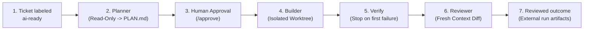

# Software Factory

A **vendor-neutral, Linux-first ticket workflow** that plans, implements, verifies, and reviews scoped changes in a caller-provided `ai/` linked worktree. Phase 1 stores a reviewed outcome; Draft PR creation and automatic worktree management are deferred.

---

## Core Principles

- **Small, Focused Agent Roles:** Work is split into **Planner** (read-only), **Builder** (write + test), and **Reviewer** (fresh-context diff audit) so no single session loses focus.
- **Deterministic Verification:** Configured `secret_scan`, `lint`, `typecheck`, and `test` checks run in order and stop at the first failure. Automated repair retries are deferred.
- **Linux Isolation:** Child commands run through Bubblewrap (`bwrap`) with user namespaces and scoped workspace access. The caller supplies a linked `ai/` worktree.
- **Configurable CLI and Trackers:** OpenCode, Agy, and Codex runners plus Local Markdown and GitHub trackers are selected through configuration; OpenCode remains the default.
- **Privacy & Fail-Closed Security:** Supports per-repo `ignore_paths`, pre-push secret scanning (`gitleaks`), Zero-Footprint external contexts, and `allow_cloud_llm: false` fail-closed routing. Protected runs receive no raw Git metadata.

---

## How It Works



---

## Quick Start

Development requires Node.js v26.13.1. Production execution requires Linux, Bubblewrap with user namespaces,
a private `config/runtime-profile.yaml`, and a dedicated unprivileged service account. The sandbox uses an
empty controlled root and fresh home; see the [runtime profile setup](INTEGRATION_GUIDE.md#required-linux-runtime-profile).
Install the locked dependencies and run checks with:

```bash
yarn install --frozen-lockfile
yarn verify
```

1. **Set up environment variables:**

   ```bash
   cp .env.example .env
   ```

   Fill in only the keys for the providers and trackers you use (`.env` is gitignored).

2. **Configure global adapters and models:**
   Review and adjust [config/factory.yaml](config/factory.yaml) and [config/models.yaml](config/models.yaml).

3. **Register your repositories:**

   ```bash
   cp config/repos.example.yaml config/repos.yaml
   ```

   Add your local repository paths, `allowed_approvers`, `verification` commands, and `privacy` rules (`config/repos.yaml` is gitignored).

4. **Follow the full setup walkthrough:**
   See [INTEGRATION_GUIDE.md](INTEGRATION_GUIDE.md) for step-by-step instructions on connecting personal, team, and confidential NDA repositories.

TypeScript 6.0.2 is pinned because the current stable TypeScript ESLint parser does not support TypeScript 7 yet. Upgrade when stable parser support is available.

---

## Repository Structure

```text
software_factory/
├── config/
│   ├── factory.yaml                     # Global adapters, limits, worktree & security flags
│   ├── models.yaml                      # Provider registry & role-to-model routing
│   ├── repos.example.yaml               # Committed template for connecting target repos
│   ├── repos.yaml                       # Local private repo registry (gitignored)
│   └── contexts/
│       └── global-factory-rules.md      # Global security & workflow rules (merge precedence)
├── src/
│   ├── agents/                          # Planner, Builder, Reviewer roles + run.sh entry point
│   ├── engine/                          # Orchestrator, state_manager, workspace, context_builder
│   ├── self_healing/                    # Verifier, error_parser, retry_loop
│   └── adapters/                        # Swappable llm, cli_runner, tracker, git_host, notifier
├── templates/                           # Starter templates (e.g., AGENTS.template.md)
├── docs/
│   ├── architecture.md                  # Module breakdown & adapter architecture
│   └── system_design.md                 # Sequence diagrams, state machine & JSON contracts
├── logs/                                # Run history, error logs, and cost tracking
├── AGENTS.md                            # Development rules, workflow, and code style guide
├── INTEGRATION_GUIDE.md                 # Step-by-step consumer & developer onboarding guide
└── .env.example                         # Environment variable template
```

---

## Documentation

| Document                                       | Audience                 | Purpose                                                                                 |
| :--------------------------------------------- | :----------------------- | :-------------------------------------------------------------------------------------- |
| [INTEGRATION_GUIDE.md](INTEGRATION_GUIDE.md)   | Consumers & Developers   | Step-by-step setup, connecting brownfield/private repos, and day-to-day usage           |
| [AGENTS.md](AGENTS.md)                         | Contributors & AI Agents | Development rules, workflow, protected files, and wrong vs. right code examples         |
| [docs/architecture.md](docs/architecture.md)   | Developers               | Folder layout, adapter boundaries, context layering, and configuration-driven switching |
| [docs/system_design.md](docs/system_design.md) | Developers               | End-to-end sequence flow, ticket state machine, JSON data contracts, and guardrails     |

---

## Build Roadmap

- **Phase 1 (MVP):** Linux runtime-profile sandbox checks and a real Agy lifecycle passed on Debian 13 ARM64. The test used synthetic local approval and a synthetic repository; it did not create a PR. Codex and OpenCode have adapter tests, not live-provider tests. See the [runtime profile and acceptance details](INTEGRATION_GUIDE.md#required-linux-runtime-profile).
- **Phase 2 (Automation):** Automatic worktree lifecycle, locking, self-healing retries, Draft PRs, and notifications.
- **Phase 3 (Multi-Repo & Scale):** Multi-repo runner via `config/repos.yaml`, parallel worktrees, and local Ollama hot-swapping.
