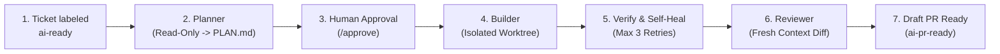

# Software Factory

A **vendor-neutral, Git-worktree-isolated Spec-to-PR pipeline** that turns well-scoped tickets into tested **Draft Pull Requests** across your existing (brownfield) and new repositories—while keeping humans in control of planning approval and final code merges.

---

## Core Principles

- **Small, Focused Agent Roles:** Work is split into **Planner** (read-only), **Builder** (write + test), and **Reviewer** (fresh-context diff audit) so no single session loses focus.
- **Deterministic Verification & Self-Healing:** Real commands (`secret_scan`, `lint`, `typecheck`, `test`) verify every change, with an `error_parser` and a 3-retry circuit breaker.
- **Safe Isolation:** Agents never edit `main` or `develop`. Every ticket runs inside an isolated `git worktree` on an `ai/` branch and opens a **Draft PR** only.
- **Zero Vendor Lock-In:** Issue trackers (GitHub, GitLab, Jira, Local MD), LLM providers (OpenRouter, OpenCode Go, Copilot, Ollama), CLI runners, and notifiers plug in behind `src/adapters/` and switch via YAML config.
- **Privacy & Fail-Closed Security:** Supports per-repo `ignore_paths`, pre-push secret scanning (`gitleaks`), Zero-Footprint external contexts, and `allow_cloud_llm: false` fail-closed routing to local models.

---

## How It Works



---

## Quick Start

1. **Set up environment variables:**
   ```bash
   cp .env.example .env
   ```
   Fill in only the keys for the providers and trackers you use (`.env` is gitignored).

2. **Configure global adapters and models:**
   Review and adjust [config/factory.yaml](config/factory.yaml) and [config/models.yaml](config/models.yaml).

3. **Register your repositories:**
   ```bash
   cp config/repos.example.yaml config/repos.yaml
   ```
   Add your local repository paths, `allowed_approvers`, `verification` commands, and `privacy` rules (`config/repos.yaml` is gitignored).

4. **Follow the full setup walkthrough:**
   See [INTEGRATION_GUIDE.md](INTEGRATION_GUIDE.md) for step-by-step instructions on connecting personal, team, and confidential NDA repositories.

---

## Repository Structure

```text
software_factory/
├── config/
│   ├── factory.yaml                     # Global adapters, limits, worktree & security flags
│   ├── models.yaml                      # Provider registry & role-to-model routing
│   ├── repos.example.yaml               # Committed template for connecting target repos
│   ├── repos.yaml                       # Local private repo registry (gitignored)
│   └── contexts/
│       └── global-factory-rules.md      # Global security & workflow rules (merge precedence)
├── src/
│   ├── agents/                          # Planner, Builder, Reviewer roles + run.sh entry point
│   ├── engine/                          # Orchestrator, state_manager, workspace, context_builder
│   ├── self_healing/                    # Verifier, error_parser, retry_loop
│   └── adapters/                        # Swappable llm, cli_runner, tracker, git_host, notifier
├── templates/                           # Starter templates (e.g., AGENTS.template.md)
├── docs/
│   ├── architecture.md                  # Module breakdown & adapter architecture
│   └── system_design.md                 # Sequence diagrams, state machine & JSON contracts
├── logs/                                # Run history, error logs, and cost tracking
├── AGENTS.md                            # Development rules, workflow, and code style guide
├── INTEGRATION_GUIDE.md                 # Step-by-step consumer & developer onboarding guide
└── .env.example                         # Environment variable template
```

---

## Documentation

| Document | Audience | Purpose |
| :--- | :--- | :--- |
| [INTEGRATION_GUIDE.md](INTEGRATION_GUIDE.md) | Consumers & Developers | Step-by-step setup, connecting brownfield/private repos, and day-to-day usage |
| [AGENTS.md](AGENTS.md) | Contributors & AI Agents | Development rules, workflow, protected files, and wrong vs. right code examples |
| [docs/architecture.md](docs/architecture.md) | Developers | Folder layout, adapter boundaries, context layering, and configuration-driven switching |
| [docs/system_design.md](docs/system_design.md) | Developers | End-to-end sequence flow, ticket state machine, JSON data contracts, and guardrails |

---

## Build Roadmap

- **Phase 1 (MVP):** Core config, `AGENTS.md`, `src/agents/run.sh`, role prompts, and a single-repo Plan -> Build -> Verify loop.
- **Phase 2 (Automation):** `git worktree` isolation, 3-retry self-healing loop with `error_parser`, and Telegram/Discord notifications.
- **Phase 3 (Multi-Repo & Scale):** Multi-repo runner via `config/repos.yaml`, parallel worktrees, and local Ollama hot-swapping.
