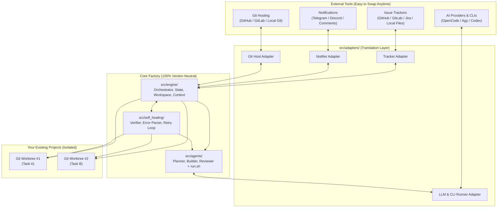
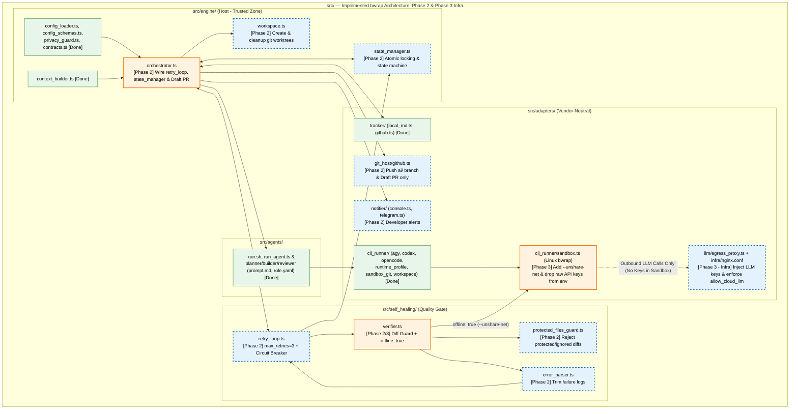
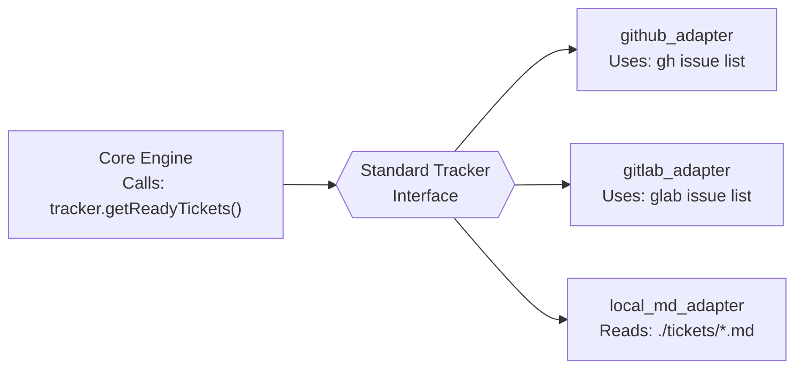

# Software Factory — Architecture Guide

This document explains the **structure** of the Software Factory. It is designed to be simple for beginners, safe for existing projects, and **100% free from Vendor Lock-in**.

---

## 1. Core Principles

Before looking at folders, keep these 4 simple rules in mind:

1. **Small, Focused Roles:** One AI does not do everything. We split the work into **Planner**, **Builder**, and **Reviewer**. Each role starts with a fresh, clean memory (context).
2. **Real Tools Check the Code:** Never trust an AI when it says _"I fixed it."_ Always run real commands (lint, typecheck, tests, build) to prove the code works.
3. **Safe Isolation:** The caller supplies an `ai/` linked worktree. Linux child processes run in Bubblewrap with scoped repository access. Draft PR delivery is deferred beyond Phase 1.
4. **Zero Vendor Lock-in:** The core uses adapters for Local Markdown and GitHub trackers and OpenCode, Agy, or Codex CLI runners.

---

## 2. Complete Folder Structure

Here is the expanded version of your folder tree. Every folder has one clear job:

```text
software_factory/
├── config/                             # Settings files (change tools here, not in code)
│   ├── factory.yaml                    # Global limits (max retries, active adapters)
│   ├── models.yaml                     # Assigns which AI model runs each role
│   ├── repos.example.yaml              # Committed template for connecting existing projects
│   ├── repos.yaml                      # Your local project registry (gitignored for privacy)
│   ├── runtime-profile.example.yaml    # Operator-owned Linux bwrap allowlist template
│   ├── runtime-profile.yaml            # Local Linux bwrap mount/command closure (gitignored)
│   └── contexts/                       # Optional external AGENTS.md / extra rules for client repos
│
├── src/
│   ├── agents/                         # AI roles and prompt instructions
│   │   ├── planner/                    # prompt.md + role.yaml (read-only)
│   │   ├── builder/                    # prompt.md + role.yaml (read-write)
│   │   ├── reviewer/                   # prompt.md + role.yaml (read-only)
│   │   ├── run.sh                      # Shell entry point delegating to run_agent.ts
│   │   └── run_agent.ts                # Resolves role/repo config, runs CLI inside bwrap, writes AgentResult
│   │
│   ├── engine/                         # Host Orchestration Layer (Trusted Zone)
│   │   ├── config_loader.ts            # Loads & merges factory, models, and repo configs
│   │   ├── config_schemas.ts           # Zod validation schemas for configs
│   │   ├── contracts.ts                # Standard Ticket, AgentResult, and VerificationResult contracts
│   │   ├── privacy_guard.ts            # Fail-closed check for privacy.allow_cloud_llm
│   │   ├── context_builder.ts          # Collects AGENTS.md + Ticket + Plan + Diff
│   │   ├── orchestrator.ts             # Runs planTicket & resumeTicket (Plan -> Build -> Verify -> Review)
│   │   ├── state_manager.ts            # [Phase 2] Atomic ticket locking & full state machine
│   │   └── workspace.ts                # [Phase 2] Automatic git worktree creation & cleanup
│   │
│   ├── self_healing/                   # Deterministic Quality Gate
│   │   ├── verifier.ts                 # Runs secret_scan -> lint -> typecheck -> test in bwrap
│   │   ├── error_parser.ts             # [Phase 2] Trims noisy terminal logs into focused failure summaries
│   │   ├── retry_loop.ts               # [Phase 2] Caps self-healing retries (max 3) with circuit breaker
│   │   └── protected_files_guard.ts    # [Phase 2] Blocks diffs touching .env, workflows, or ignore_paths
│   │
│   └── adapters/                       # Anti-Vendor-Lock-in Layer (Swappable Plugins)
│       ├── cli_runner/                 # opencode.ts, agy.ts, codex.ts, sandbox.ts (bwrap),
│       │                               # sandbox_git.ts, runtime_profile.ts, workspace.ts
│       ├── tracker/                    # local_md.ts, github.ts (+ future GitLab/Jira)
│       ├── git_host/                   # [Phase 2] github.ts (ai/ branch push + Draft PR only)
│       ├── notifier/                   # [Phase 2] console.ts, telegram.ts (+ future Discord/Slack)
│       └── llm/                        # [Phase 3 - Infra] egress_proxy.ts (outbound LLM gateway client)
│
├── infra/                              # [Phase 3 - Infra] Local Nginx Egress Proxy
│   ├── docker-compose.yml              # Runs outbound-only LLM proxy container
│   └── nginx.conf                      # Injects LLM API keys & enforces allow_cloud_llm routing
│
├── templates/
│   └── AGENTS.template.md              # Starter project guide for existing repos
│
└── logs/                               # Run history, error logs, and cost tracking
```

> **Tip for Beginners:** You can write the files inside `engine/`, `self_healing/`, and `adapters/` using **Bash**, **Node.js (TypeScript)**, or **Python**. Because they talk through simple files and JSON, the design stays the same no matter which language you prefer.

---

## 3. High-Level Architecture Diagram

This diagram shows how the **Core Factory** stays completely separate from **External Tools** by sitting behind the **Adapters Layer**.



### 3.1 Phase 1 `bwrap` Architecture, Phase 2 Roadmap & Egress Proxy

This diagram maps the **actual `src/` modules** after Phase 1 alongside planned Phase 2 automation and outbound Egress Proxy hardening:

- **Green (`Done — Phase 0/1`):** Implemented in `src/` today.
- **Orange (`Needs Hardening / Update`):** Implemented in Phase 1 and scheduled for specific hardening (`--unshare-net`, `retry_loop` wiring, or API key removal from sandbox env).
- **Blue dashed (`Planned — Phase 2 & Phase 3 Infra`):** Remaining automation and network hardening modules.



---

## 4. Deep Dive Into Each Module

### A. `src/agents/` (The Workers)

Instead of hardcoding prompts inside scripts, each worker lives in its own folder with clear instructions:

- **`planner/`**: Reads the ticket and project guide (`AGENTS.md`). Outputs a step-by-step `PLAN.md`. **Not allowed to edit code.**
- **`builder/`**: Reads `PLAN.md` and writes the actual code plus unit tests inside an isolated folder.
- **`reviewer/`**: Opens a brand-new session, reads `git diff`, checks for bugs or extra unnecessary code, and writes a review summary.
- **`run.sh`**: The single command the engine calls. Example:
  ```bash
  ./src/agents/run.sh --role builder --workspace /tmp/wt-42 --prompt context.md
  ```
  `run.sh` reads `config/models.yaml`, picks the right CLI adapter, runs the AI, and returns a clean exit status.

### B. `src/engine/` (The Factory Manager)

- **`orchestrator`**: Exposes `planTicket` and `resumeTicket` to run planning, approval, build, verification, and fresh review. Phase 1 records review outcomes; Draft PR creation is deferred.
- **`state_manager`**: Keeps track of where each ticket is (`ready`, `planning`, `building`, `failed`). It locks a ticket as soon as work starts so two agents never work on the same task at the same time.
- **`workspace`**: Validates a caller-provided `ai/` linked worktree and gathers a scoped diff, including eligible untracked files. Automatic worktree creation and cleanup are deferred.
- **`context_builder`**: Prepares a small, focused package of text for each agent (Ticket + `AGENTS.md` + `PLAN.md`) so the AI does not waste tokens reading unrelated files.

### C. `src/self_healing/` (Quality Control)

- **`verifier.ts`**: Runs configured `secret_scan`, `lint`, `typecheck`, and `test` commands in order inside the Linux Bubblewrap sandbox and stops on the first failure. Planned hardening adds `--unshare-net` (`offline: true`) so verification runs without host network access.
- **`error_parser.ts`** *(Phase 2)*: Terminal errors can be thousands of lines long. This module cuts out noise and extracts only the relevant failing lines and file paths.
- **`retry_loop.ts`** *(Phase 2)*: Loops failed verifier output back to `Builder` up to `max_self_heal_retries` (default `3`) before tripping the circuit breaker. Phase 1 stops after the first failed verifier step.
- **`protected_files_guard.ts`** *(Phase 2)*: Inspects the resulting diff before `git push` and blocks changes to `.env*`, `.github/workflows/*`, or configured `privacy.ignore_paths`.

### D. `src/adapters/` (How We Avoid Vendor Lock-in)

Think of adapters like a **wall power socket and travel plugs**:

- Your **Core Factory** is the wall socket. It only speaks one simple internal language (Standard Interfaces).
- Each **Adapter** is a small plug that translates between the factory and a specific service.



If tomorrow you move from **GitHub** to **GitLab**, or from **OpenRouter** to a **local Ollama model**, you do **not** touch `engine/`, `agents/`, or `self_healing/`. You only change one setting in `config/`.

---

## 5. Configuration-Driven Switching (Zero Code Changes)

To prove there is no vendor lock-in, here is how you control your tools using two simple YAML files.

### `config/factory.yaml`

Choose which external services are active right now:

```yaml
adapters:
  tracker: "github" # Options: github | gitlab | jira | local_md
  git_host: "github" # Options: github | gitlab | local_git
  cli_runner: "opencode" # Options: opencode | agy | codex
  notifier: "telegram" # Options: telegram | discord | slack | console

limits:
  max_self_heal_retries: 3
  max_parallel_tasks: 2
  agent_timeout_minutes: 15
```

### `config/models.yaml`

Mix cheap and smart models across different providers for each role:

```yaml
roles:
  planner:
    provider: "openrouter"
    model: "anthropic/claude-sonnet" # Strong reasoning for planning
  builder:
    provider: "opencode_go"
    model: "deepseek-v4-flash" # Fast and cheap for coding loops
  reviewer:
    provider: "ollama"
    model: "qwen3-coder:32b" # Free local model for diff review
```

---

## 6. Connecting Existing (Brownfield) Projects

You do **not** need to copy the factory into every project. Keep the factory in one place, copy [`config/repos.example.yaml`](../config/repos.example.yaml) to `config/repos.yaml` (gitignored so local paths and client repos stay private), and configure your repositories there.

### Structure of `config/repos.yaml`

- **`defaults` & per-repo `overrides`:** Define shared rules once (labels, `ai/` branch prefix, default models, and baseline privacy settings), and override only what differs for a specific client or confidential repo. Automatic locking, retries, PRs, and notifications are deferred.
- **`tracker` (`token_env` + `allowed_approvers`):** Reference only the environment variable name for each repo's token (never raw secrets), and restrict `/approve` to trusted maintainers.
- **`verification`:** Register deterministic checks (`secret_scan`, `lint`, `typecheck`, `test`) that run in order and stop on first failure.
- **`privacy`:** Classify each repo (`public` | `internal` | `confidential`), define `ignore_paths` (e.g., `.env*`, `certs/**`), and set `allow_cloud_llm: false` on confidential projects so the Engine fails closed if a cloud provider is configured.

### Context Layering (`AGENTS.md` Handling)

Not every existing repository is the same, so `context.mode` supports three modes:

1. **`repo_only`:** Uses the repository's existing `AGENTS.md` directly (zero duplicate maintenance).
2. **`merge`:** Combines the repository's `AGENTS.md` with a factory-side `factory_extra` file (e.g., `./config/contexts/global-factory-rules.md`) without modifying the team's file. **Precedence rule:** factory rules win on security and workflow; the repo's `AGENTS.md` wins on code style and architecture.
3. **`factory_only`:** Uses only a context file stored inside `./config/contexts/` so **zero files** are added to a client's repository (Zero Footprint).

The context builder includes the selected root instruction file inline once, and runners disable project instruction auto-loading. Additional repository instruction files are passed as safe relative path pointers. Ignored paths are never read. `factory_only` requires readable factory context and fails closed otherwise.

### Linux Runtime Boundary

Production execution targets Linux and requires Bubblewrap (`bwrap`) with user namespaces and an operator-owned `config/runtime-profile.yaml` outside the worktree and scratch directory. The sandbox uses an empty controlled root, explicit file mounts and selected package-directory mounts, a fresh `/home/factory`, and a scratch area. It does not inherit host `HOME`, Git global/system configuration, or hooks. Git metadata is available only when there are no `privacy.ignore_paths` and no blocked paths inside the workspace; protected runs receive no repository Git metadata, and the Engine supplies context and diff. The unprotected exception exposes only a scratch Git snapshot and read-only objects, refs, and packed refs. Native cached-login behavior is not verified. Isolation does not guarantee secrecy from a privileged host administrator or unrelated host processes. The caller supplies an `ai/` linked worktree; automatic worktree management is Phase 2. See the [runtime profile setup](../INTEGRATION_GUIDE.md#required-linux-runtime-profile).

**Planned Security Hardening (Network & Egress Boundary):**

- **Offline Verification (`--unshare-net`):** Phase 1 `bwrap` runs do not yet unshare the network namespace. Adding an `offline: true` mode in `src/adapters/cli_runner/sandbox.ts` for `src/self_healing/verifier.ts` will disable all network access during `secret_scan`, `lint`, `typecheck`, and `test`.
- **Outbound LLM Egress Proxy (`Nginx`):** Currently `sandbox.ts` forwards selected provider API keys (`GOOGLE_API_KEY`, `OPENAI_API_KEY`, `OPENCODE_API_KEY`) into the sandbox environment. Routing outbound LLM calls through a local outbound-only `Nginx` Egress Proxy (`infra/nginx.conf` + `src/adapters/llm/egress_proxy.ts`) keeps real API keys out of agent sandboxes, applies rate limits, and enforces `privacy.allow_cloud_llm: false` at the network boundary (allowing only local providers such as Ollama for confidential repositories).

### Phase 1 Tracker and Artifacts

The Local Markdown tracker uses ticket frontmatter for a human-managed offline approval. The GitHub adapter trusts the authenticated comment author's account, requires an exact `/approve`, checks the configured allowlist, and binds approval to the latest published plan. Plans, prompts, reports, and run metadata are stored outside the repository. Phase 1 finishes after review; PR creation, locking, retries, and notifications are deferred.
