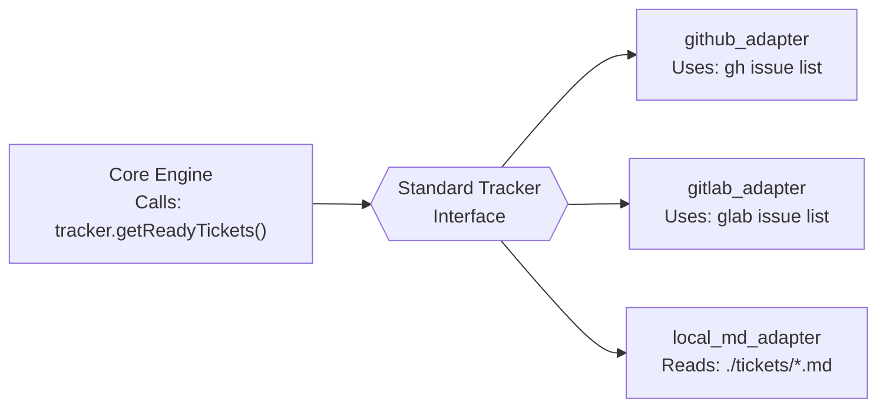

# AI Software Factory — Architecture Guide

This document explains the **structure** of the AI Software Factory. It is designed to be simple for beginners, safe for existing projects, and **100% free from Vendor Lock-in**.

---

## 1. Core Principles

Before looking at folders, keep these 4 simple rules in mind:

1. **Small, Focused Roles:** One AI does not do everything. We split the work into **Planner**, **Builder**, and **Reviewer**. Each role starts with a fresh, clean memory (context).
2. **Real Tools Check the Code:** Never trust an AI when it says *"I fixed it."* Always run real commands (lint, typecheck, tests, build) to prove the code works.
3. **Safe Isolation:** The AI never edits your main branch directly. It works inside a separate temporary folder using `git worktree` and only opens a **Draft Pull Request**.
4. **Zero Vendor Lock-in:** The core factory does not care if you use GitHub or GitLab, OpenRouter or Ollama, OpenCode or Aider, Telegram or Discord. Everything external plugs in through **Adapters**.

---

## 2. Complete Folder Structure

Here is the expanded version of your folder tree. Every folder has one clear job:

```text
ai-factory/
├── config/                         # Settings files (change tools here, not in code)
│   ├── factory.yaml                # Global limits (max retries, active adapters)
│   ├── models.yaml                 # Assigns which AI model runs each role
│   └── repos.yaml                  # List of your existing projects to manage
│
├── src/
│   ├── agents/                     # AI roles and prompt instructions
│   │   ├── planner/
│   │   │   ├── prompt.md           # Rules for writing a safe plan (no coding)
│   │   │   └── role.yaml           # Role settings (read-only, smart model)
│   │   ├── builder/
│   │   │   ├── prompt.md           # Rules for writing code and tests
│   │   │   └── role.yaml           # Role settings (read/write, fast model)
│   │   ├── reviewer/
│   │   │   ├── prompt.md           # Rules for reviewing git diff vs ticket
│   │   │   └── role.yaml           # Role settings (read-only, smart model)
│   │   └── run.sh                  # Single entry point to launch any agent role
│   │
│   ├── engine/                     # The brain that runs the assembly line
│   │   ├── orchestrator            # Runs steps in order (Plan -> Build -> Review)
│   │   ├── state_manager           # Tracks ticket status and prevents double runs
│   │   ├── workspace               # Creates & deletes isolated git worktrees
│   │   └── context_builder         # Collects AGENTS.md + Ticket + Plan for the AI
│   │
│   ├── self_healing/               # The automated test-and-fix loop
│   │   ├── verifier                # Runs project checks (lint, tests, build)
│   │   ├── error_parser            # Cleans huge error logs into short summaries
│   │   └── retry_loop              # Limits fixes to max 3 tries to save money
│   │
│   └── adapters/                   # Anti-Vendor-Lock-in Layer (Swappable Plugins)
│       ├── llm/                    # OpenRouter, OpenCode, Copilot, Ollama, Local
│       ├── cli_runner/             # OpenCode CLI, Aider, Claude Code, Codex CLI
│       ├── tracker/                # GitHub Issues, GitLab Issues, Jira, Local MD
│       ├── git_host/               # GitHub PR, GitLab MR, Bitbucket, Local Git
│       └── notifier/               # Telegram, Discord, Slack, Email, Comments
│
├── templates/
│   └── AGENTS.template.md          # Starter project guide for existing repos
│
└── logs/                           # Run history, error logs, and cost tracking
```

> **Tip for Beginners:** You can write the files inside `engine/`, `self_healing/`, and `adapters/` using **Bash**, **Node.js (TypeScript)**, or **Python**. Because they talk through simple files and JSON, the design stays the same no matter which language you prefer.

---

## 3. High-Level Architecture Diagram

This diagram shows how the **Core Factory** stays completely separate from **External Tools** by sitting behind the **Adapters Layer**.


---

## 4. Deep Dive Into Each Module

### A. `src/agents/` (The Workers)
Instead of hardcoding prompts inside scripts, each worker lives in its own folder with clear instructions:
* **`planner/`**: Reads the ticket and project guide (`AGENTS.md`). Outputs a step-by-step `PLAN.md`. **Not allowed to edit code.**
* **`builder/`**: Reads `PLAN.md` and writes the actual code plus unit tests inside an isolated folder.
* **`reviewer/`**: Opens a brand-new session, reads `git diff`, checks for bugs or extra unnecessary code, and writes a review summary.
* **`run.sh`**: The single command the engine calls. Example:
  ```bash
  ./src/agents/run.sh --role builder --workspace /tmp/wt-42 --prompt context.md
  ```
  `run.sh` reads `config/models.yaml`, picks the right CLI adapter, runs the AI, and returns a clean exit status.

### B. `src/engine/` (The Factory Manager)
* **`orchestrator`**: Connects all steps together from fetching a ticket to opening a Draft PR.
* **`state_manager`**: Keeps track of where each ticket is (`ready`, `planning`, `building`, `failed`). It locks a ticket as soon as work starts so two agents never work on the same task at the same time.
* **`workspace`**: Think of `git worktree` as a **separate workbench**. Instead of switching branches in your main folder, the workspace module checks out a clean copy of the repo in a temporary folder for each ticket, then deletes it when finished.
* **`context_builder`**: Prepares a small, focused package of text for each agent (Ticket + `AGENTS.md` + `PLAN.md`) so the AI does not waste tokens reading unrelated files.

### C. `src/self_healing/` (Quality Control)
* **`verifier`**: Runs the project's real check command (for example: `npm run verify` or `pytest`).
* **`error_parser`**: Terminal errors can be thousands of lines long. This module cuts out noise and extracts only the relevant failing lines and file paths.
* **`retry_loop`**: Sends the clean error message back to the `builder` agent to fix. If it still fails after `MAX_RETRIES` (usually **3 tries**), it stops immediately and alerts you.

### D. `src/adapters/` (How We Avoid Vendor Lock-in)
Think of adapters like a **wall power socket and travel plugs**:
* Your **Core Factory** is the wall socket. It only speaks one simple internal language (Standard Interfaces).
* Each **Adapter** is a small plug that translates between the factory and a specific service.



If tomorrow you move from **GitHub** to **GitLab**, or from **OpenRouter** to a **local Ollama model**, you do **not** touch `engine/`, `agents/`, or `self_healing/`. You only change one setting in `config/`.

---

## 5. Configuration-Driven Switching (Zero Code Changes)

To prove there is no vendor lock-in, here is how you control your tools using two simple YAML files.

### `config/factory.yaml`
Choose which external services are active right now:

```yaml
adapters:
  tracker: "github"         # Options: github | gitlab | jira | local_md
  git_host: "github"        # Options: github | gitlab | local_git
  cli_runner: "opencode"    # Options: opencode | aider | claude_code | codex
  notifier: "telegram"      # Options: telegram | discord | slack | console

limits:
  max_self_heal_retries: 3
  max_parallel_tasks: 2
  agent_timeout_minutes: 15
```

### `config/models.yaml`
Mix cheap and smart models across different providers for each role:

```yaml
roles:
  planner:
    provider: "openrouter"
    model: "anthropic/claude-sonnet"     # Strong reasoning for planning
  builder:
    provider: "opencode_go"
    model: "deepseek-v4-flash"           # Fast and cheap for coding loops
  reviewer:
    provider: "ollama"
    model: "qwen3-coder:32b"             # Free local model for diff review
```

---

## 6. Connecting Existing (Brownfield) Projects

You do **not** need to copy the factory into every project. Keep the factory in one place and list your existing repos in `config/repos.yaml`:

```yaml
projects:
  - name: "ecommerce-api"
    repo_url: "username/ecommerce-api"
    local_path: "/home/dev/projects/ecommerce-api"
    base_branch: "main"
    verify_command: "npm run typecheck && npm run lint && npm test"
    require_human_approval: true

  - name: "billing-service"
    repo_url: "username/billing-service"
    local_path: "/home/dev/projects/billing-service"
    base_branch: "develop"
    verify_command: "pytest"
    require_human_approval: true
```

Inside each existing project, you only need **one small file**: `AGENTS.md`. It tells the factory:
* How the folder structure works.
* Coding style rules to follow.
* Which sensitive folders are **Do Not Touch** (e.g., auth, payments, old database migrations).