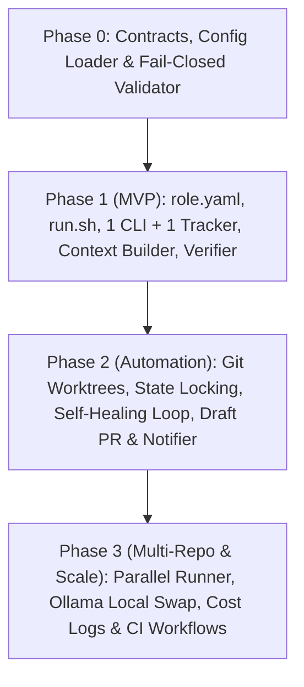

# Software Factory — Phase-by-Phase Implementation Plan

This document is the build blueprint for **Software Factory**. It breaks the remaining implementation into concrete, testable phases with exact target files, data contracts, acceptance criteria, and verification steps.

For architecture and data schemas, see [docs/architecture.md](architecture.md) and [docs/system_design.md](system_design.md). For coding standards, see [AGENTS.md](../AGENTS.md).

---

## 0. Current Baseline (Foundation and Phase 0 Complete)

The repository foundation, documentation, config templates, and agent prompts are already in place:

- **Docs & Standards:** `README.md`, `INTEGRATION_GUIDE.md`, `CONTRIBUTING.md`, `AGENTS.md`, `LICENSE`, `docs/architecture.md`, `docs/system_design.md`
- **Configuration & Contexts:** `.env.example`, `.gitignore`, `config/factory.yaml`, `config/models.yaml`, `config/repos.example.yaml`, `config/contexts/global-factory-rules.md`, `templates/AGENTS.template.md`
- **Agent Prompts:** `src/agents/planner/prompt.md`, `src/agents/builder/prompt.md`, `src/agents/reviewer/prompt.md`
- **Phase 0 Complete:** Config loading and schemas in `src/engine/config_loader.ts` and `src/engine/config_schemas.ts`, privacy checks in `src/engine/privacy_guard.ts`, contracts in `src/engine/contracts.ts`, and unit tests under `tests/unit/`.
- **Remaining Implementation:** Phase 1 and later items below, including `role.yaml`, `src/agents/run.sh`, adapters, orchestration, self-healing, and end-to-end automation.

---

## Execution Dependency Map

---

## Phase 0 — Core Contracts & Config Validation

**Goal:** Establish shared schemas, safe config loading, and fail-closed security validation before adding workflow orchestration or adapter logic.

### Target Files
- `src/engine/config_loader.ts` and `src/engine/config_schemas.ts` — Load and validate factory, model, and repository YAML; merge model roles, defaults, repo settings, and overrides; resolve secrets only for enabled repositories. An explicit selection must identify an enabled repo and cannot activate one.
- `src/engine/privacy_guard.ts` — Validate provider locality and fail closed on cloud routes for every repository, including disabled repositories.
- `src/engine/contracts.ts` — Validate `Ticket`, `AgentResult`, and `VerificationResult` against [docs/system_design.md](system_design.md).
- `tests/unit/test_config_loader.ts` and `tests/unit/test_contracts.ts` — Cover config merging, privacy, environment references, prototype keys, and contract validation.
- Tooling: `package.json`, `yarn.lock`, `tsconfig.json`, `eslint.config.mjs`, `.prettierrc.json`, `vite.config.ts`, and `vitest.config.ts`.

### Acceptance Criteria
- [x] Loading `config/repos.example.yaml` merges `defaults` and per-repo `overrides` accurately.
- [x] Missing required env vars (`api_key_env`, `token_env`) fail fast with the env var name (never printing secret values).
- [x] Setting `allow_cloud_llm: false` with a cloud provider (`is_local: false`) raises a hard failure (fail-closed).
- [x] Validating malformed `Ticket`, `AgentResult`, or `VerificationResult` payloads fails with clear field errors.

**Verification:** Node.js v26.13.1; `yarn verify` passed, including lint, typecheck, 18 unit tests, Vite build, and Node import smoke check. Independent review approved Phase 0.

---

## Phase 1 — Weekend MVP (Single-Repo Plan -> Build -> Verify)

**Goal:** Run one complete ticket end-to-end on a single local repository using one tracker adapter and one CLI runner, proving the Planner -> Human Approval -> Builder -> Verifier -> Reviewer flow.

### 1.1 Agent Role Metadata
- **Files:**
  - `src/agents/planner/role.yaml` (`access: read_only`, `prompt_file`, `output_file: PLAN.md`)
  - `src/agents/builder/role.yaml` (`access: read_write`, `prompt_file`, `output_file: BUILDER_SUMMARY.md`)
  - `src/agents/reviewer/role.yaml` (`access: read_only`, `prompt_file`, `output_file: REVIEW_REPORT.md`)

### 1.2 Single Agent Entry Point & First CLI Runner Adapter
- **Files:**
  - `src/agents/run.sh` — Strict Bash (`set -euo pipefail`). Accepts `--role`, `--workspace`, `--prompt`, `--repo-id`. Calls `privacy_guard`, resolves CLI/provider/model, enforces `agent_timeout_minutes`, invokes the configured `src/adapters/cli_runner/<cli>`, and writes `AgentResult` JSON.
  - `src/adapters/cli_runner/opencode.sh` (or your primary CLI: `aider` / `claude_code` / `codex`) — Translates standard arguments into the CLI's command flags and captures exit code + output file.

### 1.3 Context Builder (Context Layering)
- **Files:**
  - `src/engine/context_builder.<ext>`
- **Behavior:**
  - Supports `repo_only`, `merge`, and `factory_only` modes from `config/repos.yaml`.
  - **Token duplication prevention:** Checks if root `AGENTS.md` exists (auto-loaded by modern CLI agents) and injects only `factory_extra` + non-root file path pointers into the assembled prompt.
  - Attaches Ticket JSON, `PLAN.md` (for Builder/Reviewer), and `privacy.ignore_paths` reminders.

### 1.4 First Tracker Adapter (Local MD + GitHub)
- **Files:**
  - `src/adapters/tracker/local_md.<ext>` — Reads `./tickets/*.md` into standard `Ticket` JSON (enables offline/zero-API MVP testing).
  - `src/adapters/tracker/github.<ext>` — Uses `token_env` (never hardcoded) to fetch `ai-ready` issues, post `PLAN.md` comments, update labels, and verify `/approve` commenter is in `allowed_approvers`.

### 1.5 Deterministic Verifier
- **Files:**
  - `src/self_healing/verifier.<ext>`
- **Behavior:**
  - Runs configured `verification` steps in order: `secret_scan` -> `lint` -> `typecheck` -> `test`.
  - Stops on the first failing step and emits `VerificationResult` JSON (`passed`, `attempt`, `failed_step`, `summary`).

### 1.6 Minimal Single-Ticket Orchestrator
- **Files:**
  - `src/engine/orchestrator.<ext>`
- **Behavior:**
  - Executes `Planner` -> pauses for `/approve` -> executes `Builder` -> executes `Verifier` -> executes `Reviewer` in a fresh session.

### Phase 1 Acceptance Criteria
- [ ] `./src/agents/run.sh --role planner --workspace <path> --prompt <file>` produces `PLAN.md` and valid `AgentResult` JSON without modifying repo files.
- [ ] `context_builder` passes unit tests for all 3 modes (`repo_only`, `merge`, `factory_only`) without duplicating root `AGENTS.md`.
- [ ] `tracker` adapter rejects `/approve` from any user not listed in `allowed_approvers`.
- [ ] A sample ticket completes Plan -> Approve -> Build -> Verify -> Review end-to-end on a test repository.

---

## Phase 2 — Hands-Free Automation (Isolation, Self-Healing & Draft PRs)

**Goal:** Make the factory safe to run unattended with Git worktree isolation, atomic ticket locking, a 3-retry self-healing loop, protected-file diff checks, Draft PR creation, and developer alerts.

### 2.1 Git Worktree Workspace Manager
- **Files:**
  - `src/engine/workspace.<ext>`
- **Behavior:**
  - Creates isolated worktree at `${worktree_root}/<repo-id>-issue-<id>` on branch `ai/issue-<id>` branched from `base_branch`.
  - **Hard guard:** Rejects any attempt to checkout, commit, or push to `main`, `master`, or `develop`.
  - Guarantees worktree cleanup (`git worktree remove --force`) on completion or failure.

### 2.2 Ticket State Machine & Locking
- **Files:**
  - `src/engine/state_manager.<ext>`
- **Behavior:**
  - Implements exact transitions from `docs/system_design.md`: `ai_ready` -> `ai_planning` -> `needs_approval` -> `ai_approved` -> `ai_building` -> `verifying` -> `ai_reviewing` -> `ai_pr_ready` (or `ai_failed`).
  - Atomically locks a ticket (`ai_ready` -> `ai_planning`) before launching any agent so concurrent runs never double-pick a ticket.

### 2.3 Error Parser & Self-Healing Retry Loop
- **Files:**
  - `src/self_healing/error_parser.<ext>` — Strips timestamps, ANSI codes, and noisy stack frames, returning only failing test names, file paths, line numbers, and error messages.
  - `src/self_healing/retry_loop.<ext>` — Loops `Verifier` -> `Error Parser` -> `Builder` up to `max_retries` (default `3`). On circuit-breaker trip, saves full logs to `./logs/`, marks ticket `ai_failed`, and triggers notifier.

### 2.4 Protected Files & Ignore-Paths Diff Gate
- **Files:**
  - Update `src/self_healing/verifier.<ext>`
- **Behavior:**
  - Inspects `git diff --name-only <base_branch>...HEAD` before pushing.
  - Fails verification if any modified file matches `privacy.ignore_paths` or protected paths (`.env*`, `.github/workflows/*`, etc.) unless explicitly allowed.

### 2.5 Git Host Adapter (Draft PR Only)
- **Files:**
  - `src/adapters/git_host/github.<ext>`
- **Behavior:**
  - Verifies branch starts with `ai/` and `verification.secret_scan` passed before pushing.
  - Opens a **Draft PR** (`draft: true`) containing ticket reference, `PLAN.md` summary, `VerificationResult`, and Reviewer report.

### 2.6 Notifier Adapter
- **Files:**
  - `src/adapters/notifier/console.<ext>` (default local fallback)
  - `src/adapters/notifier/telegram.<ext>` (reads `TELEGRAM_BOT_TOKEN` and `TELEGRAM_CHAT_ID` from env)
- **Triggers:** `needs_approval` (plan ready), `ai_pr_ready` (Draft PR ready), `ai_failed` (circuit breaker tripped).

### Phase 2 Acceptance Criteria
- [ ] Running Builder leaves the main local repository working tree 100% untouched.
- [ ] Triggering a deliberate lint or test failure invokes `error_parser` and auto-fixes within `<= 3` retries; an unfixable failure trips the circuit breaker at attempt 3 and marks `ai_failed`.
- [ ] Modifying a protected file or introducing a fake secret causes `verifier` to block `git push`.
- [ ] Successful run opens a **Draft PR** on an `ai/issue-<id>` branch, posts Reviewer feedback, cleans up the worktree, and sends a notification.

---

## Phase 3 — Multi-Repo, Local LLM Hot-Swap & Scale

**Goal:** Run the factory across multiple brownfield and confidential repositories in parallel, prove zero vendor lock-in with a second provider/local model, and track run costs.

### 3.1 Multi-Repo Polling Runner & Parallel Execution
- **Files:**
  - `src/engine/runner.<ext>`
- **Behavior:**
  - Iterates over all `enabled: true` entries in `config/repos.yaml` every `polling_interval_seconds`.
  - Runs up to `limits.max_parallel_tasks` tickets concurrently in separate worktrees without Git lock contention.

### 3.2 Local LLM Provider & Second Adapter Proof (Zero Vendor Lock-In)
- **Files:**
  - `src/adapters/llm/ollama.<ext>` (or CLI runner config for `ollama-local`)
  - Optional additional adapters: `src/adapters/cli_runner/copilot_cli.<ext>`, `src/adapters/tracker/gitlab.<ext>`, `src/adapters/git_host/gitlab.<ext>`, `src/adapters/notifier/discord.<ext>`
- **Verification:**
  - Run a full ticket on a test repo configured with `privacy.data_classification: "confidential"`, `privacy.allow_cloud_llm: false`, `context.mode: "factory_only"`, and `ollama-local`. Confirm zero external LLM network calls and zero files added to the target repo.

### 3.3 Run History & Cost Telemetry
- **Files:**
  - `src/engine/telemetry.<ext>`
- **Behavior:**
  - Appends structured JSONL records (ticket ID, repo ID, role, provider, model, duration, tokens, `estimated_cost_usd`, final status) to `./logs/runs.jsonl` (sanitized of any secrets).

### 3.4 Optional Cloud CI Reusable Workflows
- **Files:**
  - `.github/workflows/ai-plan.yml` (`on: workflow_call`)
  - `.github/workflows/ai-build.yml` (`on: workflow_call`)
- **Behavior:**
  - Allows personal GitHub repositories to connect via the 10-line caller workflow documented in [INTEGRATION_GUIDE.md](../INTEGRATION_GUIDE.md).

### Phase 3 Acceptance Criteria
- [ ] Two tickets across different repos (or the same repo) execute concurrently in separate worktrees without conflicts.
- [ ] Confidential repo with `allow_cloud_llm: false` completes using `ollama-local` and fails closed if switched to a cloud provider.
- [ ] `./logs/runs.jsonl` accurately logs duration, tokens, and estimated cost per role run with zero secrets leaked.

---

## Definition of Done (Every Phase)

Before closing any phase or merging a PR:
1. All new modules have passing unit tests and follow [AGENTS.md](../AGENTS.md) rules.
2. Zero vendor-specific calls exist inside `src/engine/`, `src/agents/`, or `src/self_healing/`.
3. `gitleaks` / secret scan passes cleanly and `config/repos.yaml` / `.env` remain untracked.
4. `README.md`, `INTEGRATION_GUIDE.md`, and `docs/` reflect any new flags or adapters.
