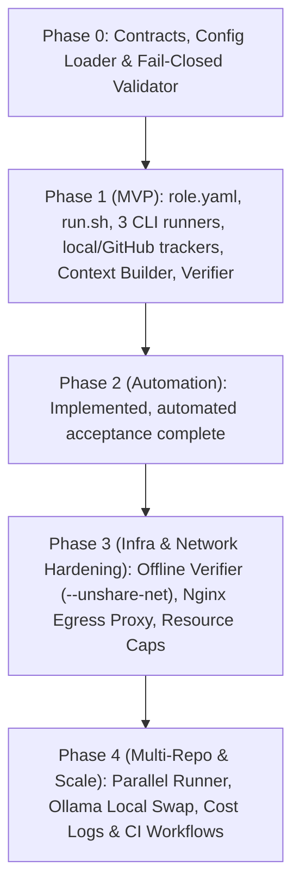

# Software Factory — Phase-by-Phase Implementation Plan

This document is the build blueprint for **Software Factory**. It breaks the remaining implementation into concrete, testable phases with exact target files, data contracts, acceptance criteria, and verification steps.

For architecture and data schemas, see [docs/architecture.md](architecture.md) and [docs/system_design.md](system_design.md). For coding standards, see [AGENTS.md](../AGENTS.md).

---

## 0. Current Baseline (Foundation and Phase 0 Complete)

The repository foundation, documentation, config templates, and agent prompts are already in place:

- **Docs & Standards:** `README.md`, `INTEGRATION_GUIDE.md`, `CONTRIBUTING.md`, `AGENTS.md`, `LICENSE`, `docs/architecture.md`, `docs/system_design.md`
- **Configuration & Contexts:** `.env.example`, `.gitignore`, `config/factory.yaml`, `config/models.yaml`, `config/repos.example.yaml`, `config/contexts/global-factory-rules.md`, `templates/AGENTS.template.md`
- **Agent Prompts:** `src/agents/planner/prompt.md`, `src/agents/builder/prompt.md`, `src/agents/reviewer/prompt.md`
- **Phase 0 Complete:** Config loading and schemas in `src/engine/config_loader.ts` and `src/engine/config_schemas.ts`, privacy checks in `src/engine/privacy_guard.ts`, contracts in `src/engine/contracts.ts`, and unit tests under `tests/unit/`.
- **Remaining Implementation:** Phase 1 acceptance and Phase 2 implementation with automated acceptance are complete. Fresh combined Linux verification and independent review passed. Live GitHub and Telegram factory acceptance is a separate operational follow-up; Phase 3 and later remain deferred.

---

## Execution Dependency Map

---

## Phase 0 — Core Contracts & Config Validation

**Goal:** Establish shared schemas, safe config loading, and fail-closed security validation before adding workflow orchestration or adapter logic.

### Target Files

- `src/engine/config_loader.ts` and `src/engine/config_schemas.ts` — Load and validate factory, model, and repository YAML; merge model roles, defaults, repo settings, and overrides; resolve secrets only for enabled repositories. An explicit selection must identify an enabled repo and cannot activate one.
- `src/engine/privacy_guard.ts` — Validate provider locality and fail closed on cloud routes for every repository, including disabled repositories.
- `src/engine/contracts.ts` — Validate `Ticket`, `AgentResult`, and `VerificationResult` against [docs/system_design.md](system_design.md).
- `tests/unit/test_config_loader.ts` and `tests/unit/test_contracts.ts` — Cover config merging, privacy, environment references, prototype keys, and contract validation.
- Tooling: `package.json`, `yarn.lock`, `tsconfig.json`, `eslint.config.mjs`, `.prettierrc.json`, `vite.config.ts`, and `vitest.config.ts`.

### Acceptance Criteria

- [x] Loading `config/repos.example.yaml` merges `defaults` and per-repo `overrides` accurately.
- [x] Missing required env vars (`api_key_env`, `token_env`) fail fast with the env var name (never printing secret values).
- [x] Setting `allow_cloud_llm: false` with a cloud provider (`is_local: false`) raises a hard failure (fail-closed).
- [x] Validating malformed `Ticket`, `AgentResult`, or `VerificationResult` payloads fails with clear field errors.

**Verification:** Node.js v26.13.1; `yarn verify` passed, including lint, typecheck, 18 unit tests, Vite build, and Node import smoke check. Independent review approved Phase 0.

---

## Phase 1 — Weekend MVP (Single-Repo Plan -> Build -> Verify)

**Goal:** Run one ticket on a single local repository using local Markdown or GitHub tracking and a selected CLI runner, proving Planner -> Human Approval -> Builder -> Verifier -> Reviewer. Phase 1 ends with a reviewed result; it does not create a Draft PR.

### 1.1 Agent Role Metadata

- **Files:**
  - `src/agents/planner/role.yaml` (`access: read_only`, `prompt_file`, `output_file: PLAN.md`)
  - `src/agents/builder/role.yaml` (`access: read_write`, `prompt_file`, `output_file: BUILDER_SUMMARY.md`)
  - `src/agents/reviewer/role.yaml` (`access: read_only`, `prompt_file`, `output_file: REVIEW_REPORT.md`)

### 1.2 Single Agent Entry Point & CLI Runner Adapters

- **Files:**
  - `src/agents/run.sh` — Strict Bash (`set -euo pipefail`). Accepts `--role`, `--workspace`, `--prompt`, `--repo-id`. Calls `privacy_guard`, resolves CLI/provider/model, enforces `agent_timeout_minutes`, invokes the configured `src/adapters/cli_runner/<cli>`, and writes `AgentResult` JSON.
  - `src/adapters/cli_runner/opencode.ts`, `agy.ts`, `codex.ts` — Translate standard arguments into native CLI invocations and capture exit code + output file. OpenCode remains the default route; Agy and Codex are explicit role overrides.

### 1.3 Context Builder (Context Layering)

- **Files:**
  - `src/engine/context_builder.<ext>`
- **Behavior:**
  - Supports `repo_only`, `merge`, and `factory_only` modes from `config/repos.yaml`.
  - **Token duplication prevention:** Includes the selected root `AGENTS.md` content inline once, with CLI project auto-loading disabled. Additional repository instruction files are safe path pointers. Ignore patterns are applied before reading.
  - Attaches Ticket JSON, `PLAN.md` (for Builder/Reviewer), and `privacy.ignore_paths` reminders.

### 1.4 First Tracker Adapter (Local MD + GitHub)

- **Files:**
  - `src/adapters/tracker/local_md.ts` — Reads `./tickets/*.md` into standard `Ticket` JSON and records a human-managed offline approval in frontmatter.
  - `src/adapters/tracker/github.ts` — Uses `token_env` (never hardcoded) to fetch `ai-ready` issues, post plans, update labels, and verify the actual `/approve` comment author is allowed and the approval follows the latest plan.

### 1.5 Deterministic Verifier

- **Files:**
  - `src/self_healing/verifier.<ext>`
- **Behavior:**
  - Runs configured `verification` steps in order: `secret_scan` -> `lint` -> `typecheck` -> `test`.
  - Stops on the first failing step and emits `VerificationResult` JSON (`passed`, `attempt`, `failed_step`, `summary`).

### 1.6 Minimal Single-Ticket Orchestrator

- **Files:**
  - `src/engine/orchestrator.<ext>`
- **Behavior:**
  - `planTicket` creates external artifacts and persists the current plan hash. `resumeTicket` requires a matching current-plan approval, validates the caller-provided `ai/` linked worktree, runs Builder, ordered Verifier, then a fresh Reviewer, and records a reviewed or rejected outcome. It does not open a PR.

### Phase 1 Acceptance Criteria

- [x] Agent runner routes OpenCode, Agy, and Codex and returns the standard `AgentResult` shape. CLI adapter coverage includes mocks; Agy also completed the real Linux lifecycle below. Codex and OpenCode were not live-tested.
- [x] `context_builder` tests all 3 modes, inline root instructions exactly once, and enforce ignore/containment checks.
- [x] Local and mocked GitHub trackers bind exact `/approve` to allowed identity and the current plan; stale and unauthorized approvals are rejected.
- [x] Orchestrator lifecycle tests cover planning, approval, builder, verifier, and fresh Reviewer outcomes; artifacts remain outside the repository.
- [x] `yarn build` imports the built orchestrator entry; the entry exports `planTicket` and `resumeTicket`.
- [x] Linux+bwrap sandbox acceptance with the required explicit runtime profile passes allowed/denied filesystem checks and the default lifecycle.
- [x] A real Agy-backed sample ticket completes through the default profile-backed `planTicket`/`resumeTicket` lifecycle with current-plan-bound synthetic local approval and default verification.

**Acceptance evidence:** On Debian 13 ARM64 with Node.js 26.13.1, Bubblewrap 0.12, and Agy 1.5.14, the profile-backed default lifecycle completed Planner, Builder, four verifier steps, and a fresh Reviewer. The Reviewer returned `APPROVE_FOR_DRAFT_PR`; only `src/math.cjs` changed in the synthetic linked worktree, while the main branch and ignored sentinels remained unchanged. The approval was synthetic and bound to the current plan hash. Codex and OpenCode have adapter tests but no live-provider acceptance.

**Runtime boundary:** Linux is the production target and requires Bubblewrap (`bwrap`) with user namespaces and an operator-owned `config/runtime-profile.yaml` outside the worktree and scratch directory. The sandbox uses an empty controlled root, exact file mounts and selected package-directory mounts, plus a fresh `/home/factory`; it does not inherit host `HOME`, Git global/system configuration, or hooks. Git metadata is omitted whenever `privacy.ignore_paths` is nonempty or a blocked path resolves inside the workspace. Only unprotected runs receive a scratch Git snapshot with read-only objects, refs, and packed refs. The Agy cached-auth file mounts described in the [runtime profile setup](../INTEGRATION_GUIDE.md#required-linux-runtime-profile) passed the live test; other credential mechanisms and provider routes remain unverified. Filesystem isolation does not claim secrecy from a privileged host administrator or unrelated host processes. The reviewed Phase 1 outcome remains `ai_reviewing`; opening a Draft PR and setting `ai_pr_ready` are Phase 2 behavior.

---

## Phase 2 — Hands-Free Automation (Isolation, Self-Healing & Draft PRs)

**Goal:** Automate an approved ticket with isolated worktrees, local atomic claims, up to three total verification attempts by default, protected-file checks, Draft-only PR delivery, and minimal developer notifications.

### 2.1 Git Worktree Workspace Manager

- **Files:**
  - `src/engine/workspace.ts`
  - `src/adapters/git_host/workspace.ts`
- **Behavior:**
  - Creates isolated worktree at `${worktree_root}/<repo-id>-issue-<id>` on branch `ai/issue-<id>` branched from `base_branch`.
  - Starts `ai/issue-<id>` from the configured base ref; `main`, `master`, and `develop` are allowed as read-only starting refs.
  - Removes only a worktree whose private ownership record, Git common directory, branch, and path still match. If proof fails, retain it for operator inspection rather than force-removing an unverified path.

### 2.2 Ticket State Machine & Locking

- **Files:**
  - `src/engine/state_manager.ts`
- **Behavior:**
  - Implements exact transitions from `docs/system_design.md`: `ai_ready` -> `ai_planning` -> `needs_approval` -> `ai_approved` -> `ai_building` -> `verifying` -> `ai_reviewing` -> `ai_pr_ready` (or `ai_failed`).
  - Claims are coordinated under the canonical configured worktree root for processes sharing that filesystem. They do not provide distributed multi-host locking or automatic stale-claim takeover. A crash may require operator inspection of the claim, ticket, artifacts, and matching worktree before recovery.

### 2.3 Error Parser & Self-Healing Retry Loop

- **Files:**
  - `src/self_healing/error_parser.ts` — Strips terminal noise while retaining useful diagnostics in a bounded summary.
  - `src/self_healing/retry_loop.ts` — Runs at most `limits.max_self_heal_retries` verification attempts (default `3` total, including the first). This allows at most two repair Builder runs. Full check output is saved under the caller's external run directory with private file permissions; only a bounded parsed summary is passed for repair.

### 2.4 Protected Files & Ignore-Paths Diff Gate

- **Files:**
  - `src/self_healing/verifier.ts`
  - `src/adapters/git_host/workspace.ts`
- **Behavior:**
  - Checks committed, staged, unstaged, untracked, and matching ignored paths against `privacy.ignore_paths` and protected paths such as `.env*`, `.github/workflows/**`, and `config/repos.yaml`.
  - Resolves a configured branch or full base commit ID to an immutable commit before diffing; invalid refs and paths escaping the worktree fail closed.

### 2.5 Git Host Adapter (Draft PR Only)

- **Files:**
  - `src/engine/automation.ts`
  - `src/engine/automation_delivery.ts`
  - `src/adapters/git_host/delivery_git.ts`
  - `src/adapters/git_host/github.ts`
- **Behavior:**
  - Commits only on the expected linked `ai/issue-<id>` worktree, rejects configured Git filters, and verifies the immutable clean commit snapshot before pushing.
  - Requires a passing verification result and configured nonempty `verification.secret_scan`. The full Reviewer report is included in the Draft PR body. An existing Draft PR is reused only when its commit and report body match the verified delivery before push.
  - If the create-PR response is uncertain, returns `delivery_pending`, retains the active claim, branch, and private artifacts, cleans only the owned worktree, and requires manual reconciliation before retry. It does not automatically repeat PR creation.

### 2.6 Notifier Adapter

- **Files:**
  - `src/adapters/notifier/console.ts` (default local fallback and selector)
  - `src/adapters/notifier/telegram.ts` (reads `TELEGRAM_BOT_TOKEN` and `TELEGRAM_CHAT_ID` from env)
- **Triggers:** `needs_approval` (plan ready), `ai_pr_ready` (Draft PR ready), `ai_failed` (circuit breaker tripped).

### Phase 2 Acceptance Criteria

Automated acceptance uses temporary Git repositories, a local bare origin, real GitHub adapter logic with mocked HTTP, synthetic agents and trackers, and notifier mocks. The fresh Linux verification used Debian 13 ARM64, Node.js v26.13.1, Yarn 1.22.22, and Bubblewrap 0.12.0. The exact `yarn verify` command passed with 24 test files, 160 tests, and 0 skipped; build/import smoke and managed API export assertions also passed. Independent review approved the implementation. Full evidence is in the operator-held `linux/fresh-final/verification-summary.md` task artifact.

- [x] Automated integration coverage confirms Builder changes stay in the isolated worktree and the source checkout remains untouched.
- [x] Automated coverage confirms repairable verification failures recover within three total attempts and terminal failure marks `ai_failed`.
- [x] Protected-path and secret-scan failures block delivery before push.
- [x] A successful mocked GitHub delivery pushes the verified commit to a local bare origin, creates a Draft PR with the full Reviewer report in its body, cleans the owned worktree, and exercises notifications.

**Operational follow-up:** Live GitHub and Telegram factory end-to-end acceptance was not performed. Run it with authorized test credentials and a test repository before operational use.

---

## Phase 3 — Infrastructure & Network Hardening (`infra/`)

**Goal:** Lock down the network, secret, and resource boundaries before scaling to multiple brownfield and confidential repositories in parallel.

### 3.1 Offline Verifier Network Isolation (`--unshare-net`)

- **Files:**
  - Update `src/adapters/cli_runner/sandbox.ts` and `src/self_healing/verifier.ts`
- **Behavior:**
  - Add an `offline?: boolean` option to `SandboxOptions` that appends `--unshare-net` to Bubblewrap arguments.
  - Enable `offline: true` by default in `verifier.ts` so `secret_scan`, `lint`, `typecheck`, and `test` execute with zero host network access (relying on pre-installed dependencies/caches).

### 3.2 Outbound LLM Egress Proxy (`infra/`)

- **Files:**
  - `infra/docker-compose.yml`
  - `infra/nginx.conf`
- **Behavior:**
  - Run an outbound-only local `Nginx` Egress Proxy container on a dedicated loopback/internal interface.
  - Inject provider LLM API keys (`OPENROUTER_API_KEY`, `OPENAI_API_KEY`, `GOOGLE_API_KEY`, etc.) exclusively at the proxy layer, apply per-provider rate limits, and enforce `privacy.allow_cloud_llm: false` at the network boundary (allowing only local providers such as Ollama for confidential repositories).

### 3.3 Egress Proxy Adapter & Sandbox Secret Removal

- **Files:**
  - `src/adapters/llm/egress_proxy.ts`
  - Update `src/adapters/cli_runner/sandbox.ts`, `src/engine/config_schemas.ts`, and `src/engine/privacy_guard.ts`
- **Behavior:**
  - Route agent CLI LLM calls to the local `Nginx` Egress Proxy endpoint with repository privacy policy routing.
  - Remove raw provider API keys from `forwardedEnvironment` in `sandbox.ts` when Egress Proxy mode is enabled so compromised code or tools inside `bwrap` cannot read or exfiltrate real credentials.

### 3.4 Process & Resource Limits Hardening

- **Files:**
  - Update `src/adapters/cli_runner/sandbox.ts` and `config/factory.yaml`
- **Behavior:**
  - Enforce configurable CPU, memory, and PID limits (e.g., via `systemd-run --user --scope` or `prlimit`) alongside `agent_timeout_minutes` and `MAX_OUTPUT_BYTES`.

### Phase 3 Acceptance Criteria

- [ ] `verifier.ts` runs inside `bwrap --unshare-net`; unit/integration tests confirm outbound network calls from verification commands fail.
- [ ] Agent sandboxes running in Egress Proxy mode contain zero raw provider API keys in `process.env` while successfully completing LLM requests through `infra/nginx.conf`.
- [ ] A confidential repository (`allow_cloud_llm: false`) is blocked at both `privacy_guard.ts` and `infra/nginx.conf` if routed to a cloud provider.
- [ ] CPU, memory, and PID caps terminate runaway verification or build processes cleanly without destabilizing the host.

---

## Phase 4 — Multi-Repo, Local LLM Hot-Swap & Scale

**Goal:** Run the factory across multiple brownfield and confidential repositories in parallel on top of the hardened Phase 3 network boundary, prove zero vendor lock-in with a second provider/local model, and track run costs.

### 4.1 Multi-Repo Polling Runner & Parallel Execution

- **Files:**
  - `src/engine/runner.<ext>`
- **Behavior:**
  - Iterates over all `enabled: true` entries in `config/repos.yaml` every `polling_interval_seconds`.
  - Runs up to `limits.max_parallel_tasks` tickets concurrently in separate worktrees without Git lock contention.

### 4.2 Local LLM Provider & Second Adapter Proof (Zero Vendor Lock-In)

- **Files:**
  - `src/adapters/llm/ollama.<ext>` (or CLI runner config for `ollama-local`)
  - Optional additional adapters: `src/adapters/cli_runner/copilot_cli.<ext>`, `src/adapters/tracker/gitlab.<ext>`, `src/adapters/git_host/gitlab.<ext>`, `src/adapters/notifier/discord.<ext>`
- **Verification:**
  - Run a full ticket on a test repo configured with `privacy.data_classification: "confidential"`, `privacy.allow_cloud_llm: false`, `context.mode: "factory_only"`, and `ollama-local`. Confirm zero external LLM network calls and zero files added to the target repo.

### 4.3 Run History & Cost Telemetry

- **Files:**
  - `src/engine/telemetry.<ext>`
- **Behavior:**
  - Appends structured JSONL records (ticket ID, repo ID, role, provider, model, duration, tokens, `estimated_cost_usd`, final status) to `./logs/runs.jsonl` (sanitized of any secrets).

### 4.4 Optional Cloud CI Reusable Workflows

- **Files:**
  - `.github/workflows/ai-plan.yml` (`on: workflow_call`)
  - `.github/workflows/ai-build.yml` (`on: workflow_call`)
- **Behavior:**
  - Allows personal GitHub repositories to connect via the 10-line caller workflow documented in [INTEGRATION_GUIDE.md](../INTEGRATION_GUIDE.md).

### Phase 4 Acceptance Criteria

- [ ] Two tickets across different repos (or the same repo) execute concurrently in separate worktrees without conflicts.
- [ ] Confidential repo with `allow_cloud_llm: false` completes using `ollama-local` and fails closed if switched to a cloud provider.
- [ ] `./logs/runs.jsonl` accurately logs duration, tokens, and estimated cost per role run with zero secrets leaked.

---

## Definition of Done (Every Phase)

Before closing any phase or merging a PR:

1. All new modules have passing unit tests and follow [AGENTS.md](../AGENTS.md) rules.
2. Zero vendor-specific calls exist inside `src/engine/`, `src/agents/`, or `src/self_healing/`.
3. `gitleaks` / secret scan passes cleanly and `config/repos.yaml` / `.env` remain untracked.
4. `README.md`, `INTEGRATION_GUIDE.md`, and `docs/` reflect any new flags or adapters.
