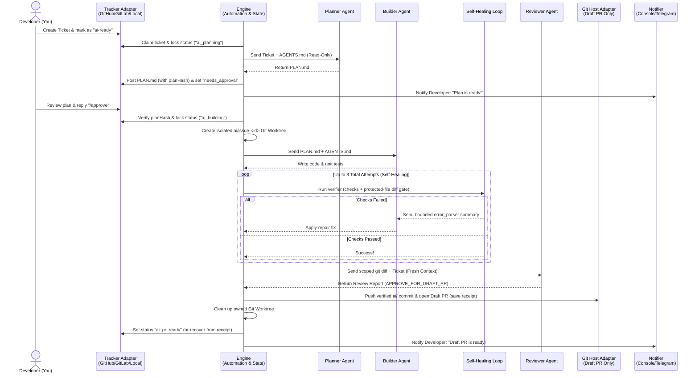
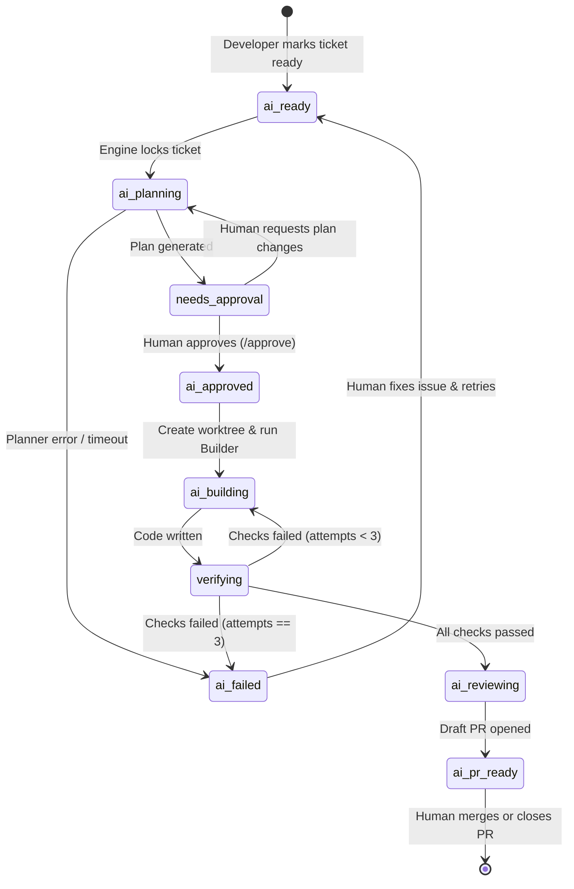
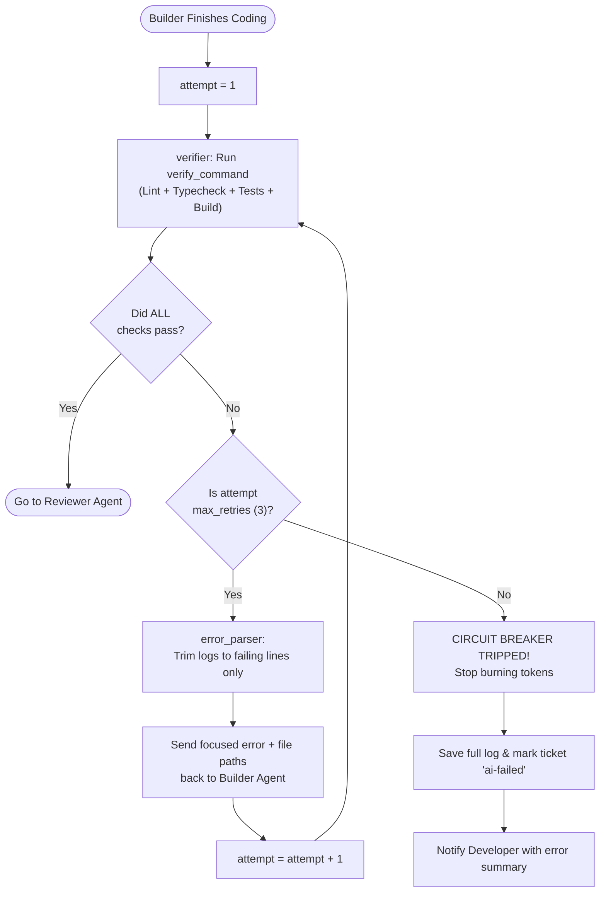
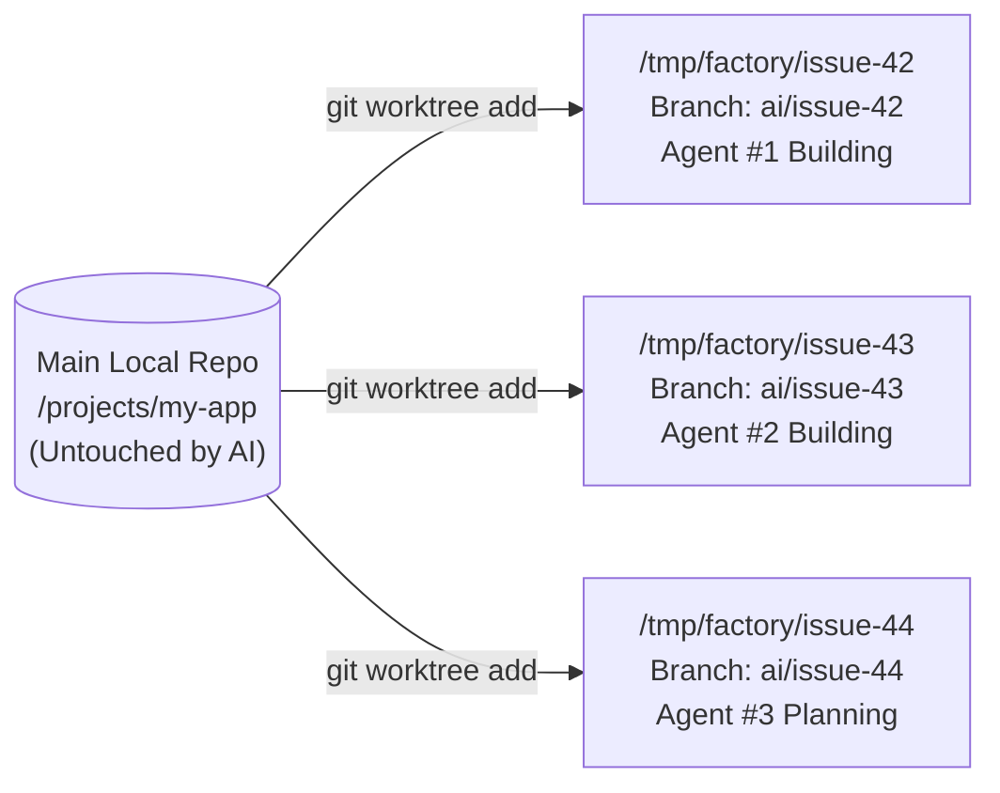

# Software Factory — System Design

While `architecture.md` shows **what** the parts are, this document explains **how** the factory runs step-by-step, how data moves between modules, how errors are handled, and how we keep your code and budget safe.

---

## 1. End-to-End Execution Flow

This sequence diagram shows the managed Phase 2 ticket lifecycle (`planManagedTicket` / `resumeManagedTicket`) from ticket claim through Draft PR delivery and verified worktree cleanup.



---

## 2. Ticket Lifecycle (State Machine)

To make sure the factory never gets confused or runs the same ticket twice, every ticket follows strict states managed by `src/engine/state_manager`.



### Locking Rule (Preventing Duplicate Work)

When the Engine picks up an `ai_ready` ticket, its **very first action** is changing the state to `ai_planning` before running any AI model. If another runner checks 5 seconds later, it will ignore that ticket.

---

## 3. Self-Healing Loop Design

The Self-Healing module (`src/self_healing/`) acts like an automatic quality gate with a **Circuit Breaker** (a safety fuse that cuts power if something keeps failing).



### Why `error_parser` Matters

If a test fails and outputs 2,000 lines of stack traces, sending all 2,000 lines to the AI wastes money and confuses the model. The `error_parser` strips timestamps and noise, keeping only the failing test names, file names, line numbers, and error messages.

---

## 4. Standard Data Contracts (Vendor-Neutral Formats)

To avoid Vendor Lock-in, every Adapter must convert external data into these simple standard JSON shapes before handing it to the Core Engine.

### A. Standard `Ticket` Object (Output of any Tracker Adapter)

Whether the ticket comes from GitHub, GitLab, Jira, or a local Markdown file, the Engine always receives this exact format:

```json
{
  "id": "42",
  "project": "ecommerce-api",
  "title": "Return HTTP 400 on duplicate email signup",
  "description": "When a user signs up with an existing email, return 400 instead of 500.",
  "acceptance_criteria": [
    "POST /api/signup returns status 400 if email exists",
    "Unit test covers duplicate email case"
  ],
  "state": "ai_ready",
  "author": "your-username",
  "url": "https://github.com/username/ecommerce-api/issues/42"
}
```

### B. Standard `AgentResult` Object (Output of `src/agents/run.sh`)

No matter which CLI tool (`opencode`, `aider`, `claude`) or LLM provider runs, `run.sh` writes a simple result file:

```json
{
  "role": "builder",
  "status": "success",
  "provider_used": "opencode_go",
  "model_used": "deepseek-v4-flash",
  "duration_seconds": 48,
  "tokens_used": null,
  "estimated_cost_usd": null,
  "output_file": "/tmp/wt-42/agent_output.md"
}
```

`tokens_used` and `estimated_cost_usd` are nullable because native CLI runners may not expose reliable usage or cost data. `null` means unavailable; numeric zero means measured zero.

For each Planner, Builder, and Reviewer attempt, the runner also writes captured stderr unchanged to `stderr.log`
in that attempt's private output directory, including when the process succeeds with warnings or exits by
failure, timeout, or output limit. A centralized `writeRunLog` function creates log files exclusively with owner-only permissions;
the caller validates that the run directory is private and external to the workspace. Raw log files are not
automatically attached to `AgentResult`, managed API responses, pull requests, or notifications. New agent
failure summaries contain only the private log path and safe process metadata. Existing verifier summaries
retain their current behavior and may include focused command diagnostics or snippets. Logs may contain
sensitive data, so operators must inspect them locally and keep them private. Capture remains bounded to 8 MiB
per stream, and the log contains only output actually captured. Failures before sandbox capture begins cannot
produce a stderr log; a returned result creates one even when stderr is empty. Existing runs are not backfilled.
See [the integration guide](../INTEGRATION_GUIDE.md) for operator steps.

### C. Standard `VerificationResult` Object (Output of `src/self_healing/verifier`)

```json
{
  "passed": false,
  "attempt": 1,
  "failed_step": "unit_tests",
  "summary": "FAIL src/auth/signup.test.ts: Expected status 400, received 500 at line 28"
}
```

---

## 5. Deployment Modes & Parallel Scaling

Because the Engine is decoupled from the trigger, you can run the exact same factory in **two ways**:

| Feature               | Mode A: Local Polling Runner                                  | Mode B: Cloud / CI Runner                                                    |
| :-------------------- | :------------------------------------------------------------ | :--------------------------------------------------------------------------- |
| **How it triggers**   | A loop on your laptop/VPS checks the Tracker every 60 seconds | Webhooks or CI events (e.g., GitHub Actions / GitLab CI) trigger immediately |
| **Server Cost**       | $0 (runs on your machine)                                     | Free tier or small CI minutes                                                |
| **Client Repos**      | **Best choice** (adds zero workflow files to client repos)    | Requires adding a tiny 10-line caller file to the repo                       |
| **24/7 Availability** | Only while your machine or VPS is on                          | Always on, controllable from your phone                                      |

### Running Multiple Tasks in Parallel Safely

Using `src/engine/workspace`, one local repository can safely run multiple agents at the same time without Git conflicts:



---

## 6. Safety, Security & Cost Guardrails

Never run autonomous AI agents without hard safety walls. This design enforces **7 non-negotiable guardrails**:

1. **Owner-Only Approval (`allowed_approvers`):** The `/approve` command is only accepted if the commenter matches the authorized owner/maintainer list in `config/repos.yaml`. Strangers cannot trigger your AI or spend your credits.
2. **Draft PRs Only + Branch Protection:** The factory is physically blocked from pushing to `main` or `develop`. It can only push to branches prefixed with `ai/` and open **Draft PRs**.
3. **Hard Circuit Breakers:**
   - Max retries per ticket: `3` (overridable per repo via `overrides.max_retries`)
   - Max runtime per agent call: `15 minutes`
   - Max cost/budget cap set directly at the LLM provider dashboard.
4. **Secret Isolation & Gitignored Config:** Keep `config/repos.yaml` in `.gitignore` and commit only `config/repos.example.yaml`. Inside `repos.yaml`, reference only environment variable names (`token_env: "FINTECH_GH_TOKEN"`); store actual keys in `.env` (gitignored) or encrypted CI Secrets, never in Git or prompt text.
5. **Pre-Push Secret Scanning:** Include a local secret scanner (`gitleaks` or `trufflehog`) in `verification.secret_scan` so any accidental credential leak halts the Self-Healing Loop before `git push`.
6. **Per-Repo Privacy & Fail-Closed LLM Routing:** Each repo in `config/repos.yaml` declares `privacy.data_classification` (`public` | `internal` | `confidential`), `privacy.ignore_paths` (`.env*`, `certs/**`, `*.key`), and `privacy.allow_cloud_llm`. Every Planner, Builder, and Reviewer run requires the enabled, reachable OpenCode egress proxy and executes in an offline network namespace with only the privacy-selected Unix socket mounted. Missing or disabled proxy configuration, unsupported CLI/provider routes, or an invalid/unavailable socket fail before run artifacts or child processes are created; there is no direct-provider fallback. Provider API keys are resolved only by the trusted proxy and are never loaded by the factory or passed to an agent. If `allow_cloud_llm: false` and a cloud provider is configured, the Engine and proxy both fail closed. Local Ollama traffic uses only the local socket. If `ignore_paths` is nonempty, or a blocked path resolves inside the workspace, the sandbox masks `.git` and omits raw Git metadata so `git show` cannot bypass workspace path protections; the Engine supplies scoped context and diff instead.
7. **Protected Files & Context Layering Precedence:** Sensitive paths (`.env`, CI workflows, auth core, billing) are listed in `AGENTS.md` under **Do Not Touch** and `privacy.ignore_paths`, and `verifier` rejects diffs that modify forbidden files. When using `context.mode: "merge"`, factory rules take precedence over repo `AGENTS.md` on security and workflow, while repo `AGENTS.md` takes precedence on code style and architecture.

---

## 7. Beginner Build Roadmap (Start Small!)

Do not build every adapter on day one. Follow this 4-phase plan:

```mermaid
gantt
    title Factory Build Roadmap
    dateFormat X
    axisFormat Phase %s

    section Phase 1: MVP (Linux/Agy acceptance complete)
    Local/GitHub trackers and CLI adapter contracts :p1, 0, 1
    Context, verifier, and orchestration       :p2, 0, 1
    Profile-backed Linux sandbox and real Agy  :p3, 1, 2

    section Phase 2: Automation (Automated acceptance complete)
    Git worktree workspace manager & claims    :p5, 2, 3
    Self-healing 3-attempt loop & diff gate    :p6, 2, 4
    Draft PR delivery, receipts & notifiers    :p7, 3, 4

    section Phase 3: Infra & Network Hardening
    Offline verifier (--unshare-net)           :p8, 4, 5
    Nginx LLM Egress Proxy & key isolation     :p9, 4, 6
    Sandbox CPU/RAM/PID resource caps          :p10, 5, 6

    section Phase 4: Multi-Repo & Scale
    Multi-repo runner via repos.yaml           :p11, 6, 7
    2nd LLM provider (Ollama) & telemetry      :p12, 6, 8
    Parallel worktree execution & CI workflows :p13, 7, 8
```



- **Phase 1 (MVP, acceptance complete):** Local/GitHub trackers, CLI adapter contracts, context builder, verifier, and plan/approval/build/review lifecycle. The profile-backed Linux sandbox checks and a real Agy lifecycle passed on Debian 13 ARM64. The test used synthetic local approval and did not open a PR. The current real agent path supports OpenCode through the mandatory egress proxy; Agy and Codex adapters are not supported for agent execution. No live-provider acceptance was performed.
- **Phase 2 (Hands-Free, automated acceptance complete):** Managed worktree creation and ownership-verified cleanup, local atomic ticket claims, up to 3 total verification attempts via `error_parser` + `retry_loop`, protected-file diff gating, Draft PR delivery with `delivery_pending` and receipt-based tracker recovery, and Console/Telegram notifications. Automated Linux verification passed (`162` tests); live GitHub and Telegram acceptance remains a separate operational follow-up.
- **Phase 3 (Infra & Network Hardening):** Require the enabled `infra/` Nginx LLM Egress Proxy for every real agent run, keep provider API keys inside the proxy, and fail closed before artifacts or process creation when the proxy or route is unavailable. Run agents and `verifier` with `--unshare-net`, mounting only the privacy-selected public or local Unix socket; enforce `allow_cloud_llm: false` in both the Engine and proxy, and add CPU/RAM/PID caps.
- **Phase 4 (True No-Lock-in Scale):** Connect multiple existing projects via `repos.yaml`, run parallel worktrees safely on top of Phase 3 hardening, track run costs, and plug in local Ollama or additional adapters to test hot-swapping.
