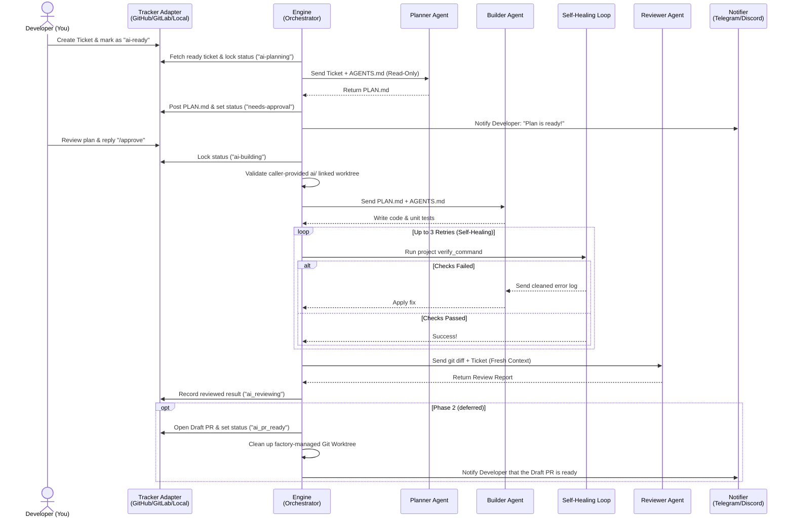
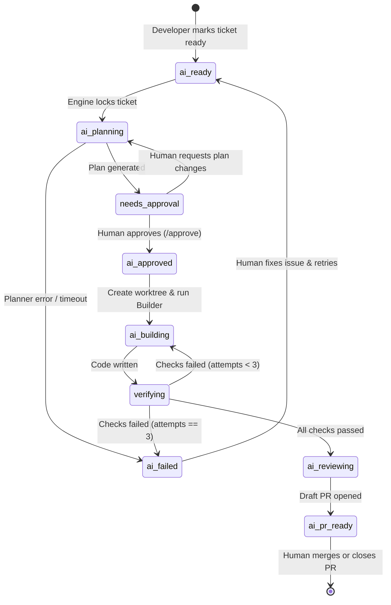
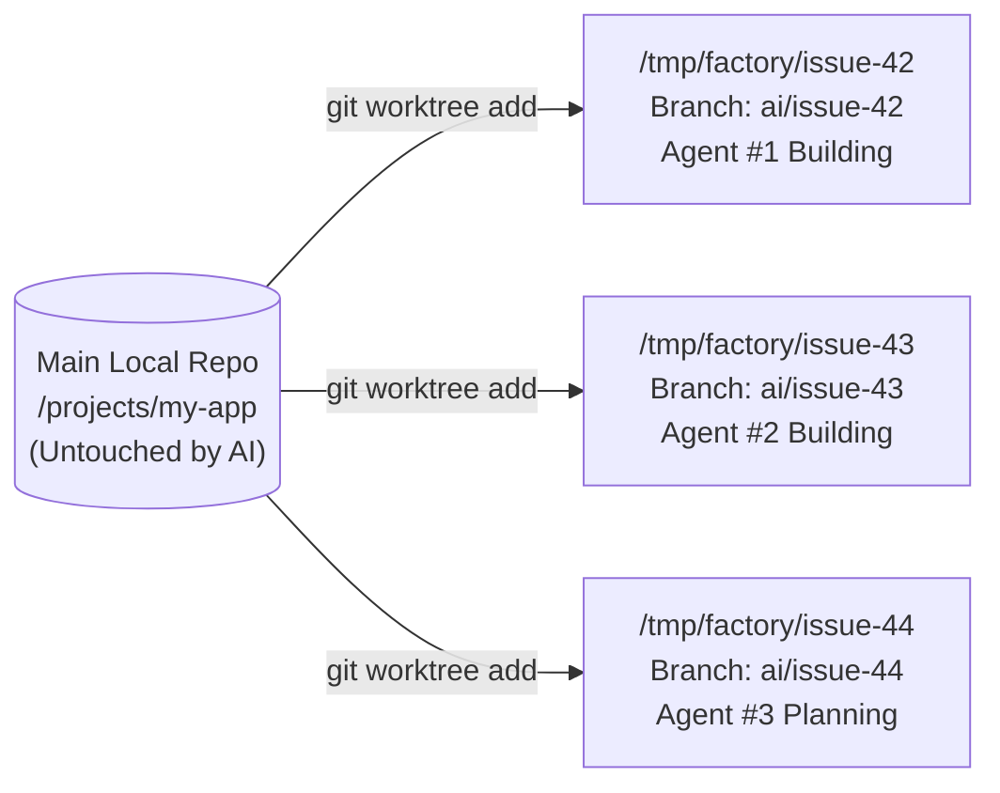

# Software Factory — System Design

While `architecture.md` shows **what** the parts are, this document explains **how** the factory runs step-by-step, how data moves between modules, how errors are handled, and how we keep your code and budget safe.

---

## 1. End-to-End Execution Flow

This sequence diagram shows the Phase 1 ticket lifecycle through a reviewed outcome and the deferred Phase 2 delivery steps.



---

## 2. Ticket Lifecycle (State Machine)

To make sure the factory never gets confused or runs the same ticket twice, every ticket follows strict states managed by `src/engine/state_manager`.



### Locking Rule (Preventing Duplicate Work)

When the Engine picks up an `ai_ready` ticket, its **very first action** is changing the state to `ai_planning` before running any AI model. If another runner checks 5 seconds later, it will ignore that ticket.

---

## 3. Self-Healing Loop Design

The Self-Healing module (`src/self_healing/`) acts like an automatic quality gate with a **Circuit Breaker** (a safety fuse that cuts power if something keeps failing).


### Why `error_parser` Matters

If a test fails and outputs 2,000 lines of stack traces, sending all 2,000 lines to the AI wastes money and confuses the model. The `error_parser` strips timestamps and noise, keeping only the failing test names, file names, line numbers, and error messages.

---

## 4. Standard Data Contracts (Vendor-Neutral Formats)

To avoid Vendor Lock-in, every Adapter must convert external data into these simple standard JSON shapes before handing it to the Core Engine.

### A. Standard `Ticket` Object (Output of any Tracker Adapter)

Whether the ticket comes from GitHub, GitLab, Jira, or a local Markdown file, the Engine always receives this exact format:

```json
{
  "id": "42",
  "project": "ecommerce-api",
  "title": "Return HTTP 400 on duplicate email signup",
  "description": "When a user signs up with an existing email, return 400 instead of 500.",
  "acceptance_criteria": [
    "POST /api/signup returns status 400 if email exists",
    "Unit test covers duplicate email case"
  ],
  "state": "ai_ready",
  "author": "your-username",
  "url": "https://github.com/username/ecommerce-api/issues/42"
}
```

### B. Standard `AgentResult` Object (Output of `src/agents/run.sh`)

No matter which CLI tool (`opencode`, `aider`, `claude`) or LLM provider runs, `run.sh` writes a simple result file:

```json
{
  "role": "builder",
  "status": "success",
  "provider_used": "opencode_go",
  "model_used": "deepseek-v4-flash",
  "duration_seconds": 48,
  "tokens_used": null,
  "estimated_cost_usd": null,
  "output_file": "/tmp/wt-42/agent_output.md"
}
```

`tokens_used` and `estimated_cost_usd` are nullable because native CLI runners may not expose reliable usage or cost data. `null` means unavailable; numeric zero means measured zero.

### C. Standard `VerificationResult` Object (Output of `src/self_healing/verifier`)

```json
{
  "passed": false,
  "attempt": 1,
  "failed_step": "unit_tests",
  "summary": "FAIL src/auth/signup.test.ts: Expected status 400, received 500 at line 28"
}
```

---

## 5. Deployment Modes & Parallel Scaling

Because the Engine is decoupled from the trigger, you can run the exact same factory in **two ways**:

| Feature               | Mode A: Local Polling Runner                                  | Mode B: Cloud / CI Runner                                                    |
| :-------------------- | :------------------------------------------------------------ | :--------------------------------------------------------------------------- |
| **How it triggers**   | A loop on your laptop/VPS checks the Tracker every 60 seconds | Webhooks or CI events (e.g., GitHub Actions / GitLab CI) trigger immediately |
| **Server Cost**       | $0 (runs on your machine)                                     | Free tier or small CI minutes                                                |
| **Client Repos**      | **Best choice** (adds zero workflow files to client repos)    | Requires adding a tiny 10-line caller file to the repo                       |
| **24/7 Availability** | Only while your machine or VPS is on                          | Always on, controllable from your phone                                      |

### Running Multiple Tasks in Parallel Safely

Using `src/engine/workspace`, one local repository can safely run multiple agents at the same time without Git conflicts:



---

## 6. Safety, Security & Cost Guardrails

Never run autonomous AI agents without hard safety walls. This design enforces **7 non-negotiable guardrails**:

1. **Owner-Only Approval (`allowed_approvers`):** The `/approve` command is only accepted if the commenter matches the authorized owner/maintainer list in `config/repos.yaml`. Strangers cannot trigger your AI or spend your credits.
2. **Draft PRs Only + Branch Protection:** The factory is physically blocked from pushing to `main` or `develop`. It can only push to branches prefixed with `ai/` and open **Draft PRs**.
3. **Hard Circuit Breakers:**
   - Max retries per ticket: `3` (overridable per repo via `overrides.max_retries`)
   - Max runtime per agent call: `15 minutes`
   - Max cost/budget cap set directly at the LLM provider dashboard.
4. **Secret Isolation & Gitignored Config:** Keep `config/repos.yaml` in `.gitignore` and commit only `config/repos.example.yaml`. Inside `repos.yaml`, reference only environment variable names (`token_env: "FINTECH_GH_TOKEN"`); store actual keys in `.env` (gitignored) or encrypted CI Secrets, never in Git or prompt text.
5. **Pre-Push Secret Scanning:** Include a local secret scanner (`gitleaks` or `trufflehog`) in `verification.secret_scan` so any accidental credential leak halts the Self-Healing Loop before `git push`.
6. **Per-Repo Privacy & Fail-Closed LLM Routing:** Each repo in `config/repos.yaml` declares `privacy.data_classification` (`public` | `internal` | `confidential`), `privacy.ignore_paths` (`.env*`, `certs/**`, `*.key`), and `privacy.allow_cloud_llm`. If `allow_cloud_llm: false` and a cloud provider is accidentally configured, the Engine **must fail closed** and refuse to run. If `ignore_paths` is nonempty, or a blocked path resolves inside the workspace, the sandbox masks `.git` and omits raw Git metadata so `git show` cannot bypass workspace path protections; the Engine supplies scoped context and diff instead.
7. **Protected Files & Context Layering Precedence:** Sensitive paths (`.env`, CI workflows, auth core, billing) are listed in `AGENTS.md` under **Do Not Touch** and `privacy.ignore_paths`, and `verifier` rejects diffs that modify forbidden files. When using `context.mode: "merge"`, factory rules take precedence over repo `AGENTS.md` on security and workflow, while repo `AGENTS.md` takes precedence on code style and architecture.

---

## 7. Beginner Build Roadmap (Start Small!)

Do not build every adapter on day one. Follow this 3-phase plan:

```mermaid
gantt
    title Factory Build Roadmap
    dateFormat X
    axisFormat Phase %s

    section Phase 1: MVP (Runtime profile acceptance pending)
    Local/GitHub trackers and three CLI routes :p1, 0, 1
    Context, verifier, and orchestration       :p2, 0, 1
    Profile-backed Linux sandbox and real Agy :p3, 1, 2

    section Phase 2: Automation
    Git worktree workspace manager         :p5, 2, 3
    Self-healing 3-retry loop              :p6, 2, 4
    Telegram or Discord notifier           :p7, 3, 4

    section Phase 3: Multi-Repo & Scale
    Add repos.yaml for existing projects   :p8, 4, 5
    Add 2nd LLM provider (e.g. Ollama)     :p9, 4, 6
    Parallel worktree execution            :p10, 5, 6
```



- **Phase 1 (MVP, implementation complete; runtime-profile acceptance pending):** Local/GitHub trackers, OpenCode/Agy/Codex routes, context builder, verifier, and plan/approval/build/review lifecycle. A real Agy ticket passed with the prior sandbox boundary, but that run does not verify the required explicit runtime profile. Codex and OpenCode have no live-provider acceptance. Phase 1 does not open a PR.
- **Phase 2 (Hands-Free):** Add `git worktree`, the `self_healing` 3-retry loop, and notifications.
- **Phase 3 (True No-Lock-in Scale):** Connect multiple existing projects via `repos.yaml` and plug in a second LLM provider or local model to test hot-swapping.
